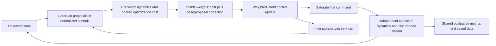

# MPPI Variant Playground

**Unified Toy Experiments for Model Predictive Path Integral Control**

A reproducible Linux/CPU research framework for comparing sampling covariance structures under shared dynamics, costs, actuator limits, seeds, and budgets. The first milestone implements four configurations of the **same information-theoretic MPPI algorithm**. This is a controlled toy comparison, with observed failures retained in the results.

MPPI samples control sequences, predicts their state trajectories, weights them by an objective and a probability-density correction, updates the nominal controls, and executes one command before replanning. Variants change the distribution, divergence, iterative search, or feedback architecture to address exploration, computation, and robustness. Testing these changes on shared small problems makes their trade-offs easier to inspect, without transferring conclusions between unrelated robots.



## Implemented and planned

| Configuration | Normalized sampling covariance | Status |
|---|---|---|
| Standard MPPI | `diag(0.28, 0.16)` | Implemented |
| Fixed isotropic MPPI | `0.22 I` | Implemented |
| Fixed diagonal MPPI | `diag(0.34, 0.10)` | Implemented |
| Fixed full covariance MPPI | `[[0.28, 0.08], [0.08, 0.16]]` | Implemented |
| CEM MPC, Tsallis-VI MPC, DIAL-MPC | Different optimization laws | Planned |
| Tube-MPPI, Robust-MPPI, CC-MPPI | Require tracking or covariance steering architecture | Planned |

All four proposals have normalized trace 0.44. A **shared fixed base covariance** `diag(0.28, 0.16)` keeps the target distribution fixed. The unequal-covariance density ratio includes its quadratic perturbation term. Changing the base with each proposal would also change the regularization objective. Matching trace does not match determinant; these choices are explicitly separated in [the formulation](docs/formulations.md).

## Install on Linux

Requires Python 3.11+ and [uv](https://docs.astral.sh/uv/). The checked-in default is Python 3.12. No GPU drivers, CUDA, JAX or MuJoCo are required.

```bash
curl -LsSf https://astral.sh/uv/install.sh | sh
uv sync --frozen
export OPENBLAS_NUM_THREADS=1 OMP_NUM_THREADS=1 MPLBACKEND=Agg
uv run ruff check .
uv run ruff format --check .
uv run pytest
```

Run commands from the repository root. Output directories must be new: existing data is protected from accidental overwrite.

```bash
# Seed-42 closed-loop run; controller and scenario are selectable
uv run python experiments/run_single.py --controller standard --scenario open_space --seed 42 --output results/my_run
uv run python experiments/generate_figures.py --input results/my_run --animate

# Main paired benchmark: four covariances × three scenarios × five seeds
uv run python experiments/run_benchmark.py --mode dynamics --output results/my_comparison
uv run python experiments/generate_figures.py --input results/my_comparison --animate

# Report these modes separately; wall-clock matching uses offline latency calibration
uv run python experiments/run_benchmark.py --mode wall_clock --output results/my_wall_clock
uv run python experiments/run_benchmark.py --mode native --output results/my_native

# Small headless smoke experiment
uv run python experiments/run_single.py --samples 64 --steps 4 --output results/my_smoke
```

The three benchmark modes are matched dynamics evaluations, calibrated wall-clock target, and native YAML configuration. The last two must not be pooled with the first. Wall-clock mode logs deadline misses; it is not a hard real-time scheduler. See [the protocol](docs/benchmark_protocol.md).

## Layout

```text
configs/                 YAML dynamics, four controllers, five scenarios, costs and benchmark
src/mppi_variant_playground/
  dynamics/              Vectorized kinematic bicycle and actuator saturation
  controllers/           Controller interface and information-theoretic MPPI
  scenarios/             Execution environment, disk and swept collision geometry
  costs/                 Shared configurable cost implementation
  sampling/              SPD validation, Gaussian sampling, likelihood ratios, stable weights
  evaluation/            Paired runs, provenance, metrics and summaries
  visualization/         Headless PNG/SVG plots and GIF replay
  utils/                 YAML composition and validation
experiments/             Run one episode, run benchmark, reconstruct figures
tests/                  Numerical, reproducibility and closed-loop regression tests
docs/                   Mathematics, paper map, fidelity, protocol, findings and limitations
results/                Per-seed CSV/JSON/configurations and generated figures
.github/workflows/ci.yml CPU lint, tests and headless smoke on Python 3.11/3.12
```

Each run saves exact resolved YAML, timestamp, seed and environment stream identity, Git revision/dirty state, package versions, backend, commands, states, per-step sampling diagnostics, metrics, and a compact rollout archive. Each benchmark also saves per-seed rows, mean/SD/median summaries, descriptive 95% intervals, and paired differences against standard MPPI. Replay uses saved data and never reoptimizes.

Large rollout archives and GIF/MP4 files stay local and are ignored by Git. Re-run a benchmark to regenerate them; CSV, JSON and YAML preserve numerical evidence. PNG and SVG figures are suitable for presentation use. GIF output is supported without FFmpeg; MP4 export is not currently implemented.

## Findings and limits

Executed **180 benchmark episodes across three separately reported budget modes**, plus two additional environment checks. The matched-evaluation success counts (five seeds per cell) are:

| Controller | Open space | Narrow passage | Disturbance |
|---|---:|---:|---:|
| standard | 5/5 | 4/5 | 1/5 |
| isotropic | 3/5 | 5/5 | 0/5 |
| diagonal | 5/5 | 5/5 | 0/5 |
| full | 3/5 | 4/5 | 1/5 |

See [executed results and delivery report](docs/results.md) for measured costs, ESS, latency, validation and provenance. No statistically significant superiority is claimed. Low ESS, saturation, finite-horizon local behavior, and failure to park after a disturbance are scientifically relevant outcomes of this configuration.

Five environments are available: open space, narrow passage, obstacle field, sudden disturbance, and parameter mismatch. The milestone comparison uses the first, second and fourth. A kinematic bicycle with a disk footprint cannot reproduce aggressive tire dynamics, contact-rich locomotion, perception, or hardware timing. There are no safety or robustness guarantees for this implementation. See [limitations](docs/limitations.md) and [implementation fidelity](docs/implementation_fidelity.md).

## References

1. Williams et al., [Aggressive Driving with Model Predictive Path Integral Control](https://doi.org/10.1109/ICRA.2016.7487277), ICRA 2016.
2. Williams et al., [Information Theoretic Model Predictive Control: Theory and Applications to Autonomous Driving](https://arxiv.org/abs/1707.02342), 2017 preprint (later T-RO 2018).
3. Williams et al., [Robust Sampling Based Model Predictive Control with Sparse Objective Information](https://www.roboticsproceedings.org/rss14/p42.pdf), RSS 2018.
4. Gandhi et al., [Robust Model Predictive Path Integral Control: Analysis and Performance Guarantees](https://arxiv.org/abs/2102.09027), RA-L 2021.
5. Wang et al., [Variational Inference MPC using Tsallis Divergence](https://arxiv.org/abs/2104.00241), RSS 2021.
6. Yin et al., [Trajectory Distribution Control for MPPI using Covariance Steering](https://arxiv.org/abs/2109.12147), ICRA 2022.
7. Xue et al., [Full-Order Sampling-Based MPC for Torque-Level Locomotion Control via Diffusion-Style Annealing](https://arxiv.org/abs/2409.15610), 2024.
8. Jordana et al., [An Introduction to Zero-Order Optimization Techniques for Robotics](https://arxiv.org/abs/2506.22087), 2025.

Reference software reviewed: [Hydrax](https://github.com/vincekurtz/hydrax) and [MPPI-Generic](https://github.com/ACDSLab/MPPI-Generic). Neither is a runtime dependency. See [paper map](docs/paper_map.md) for reviewed revisions and verified equation locations.
