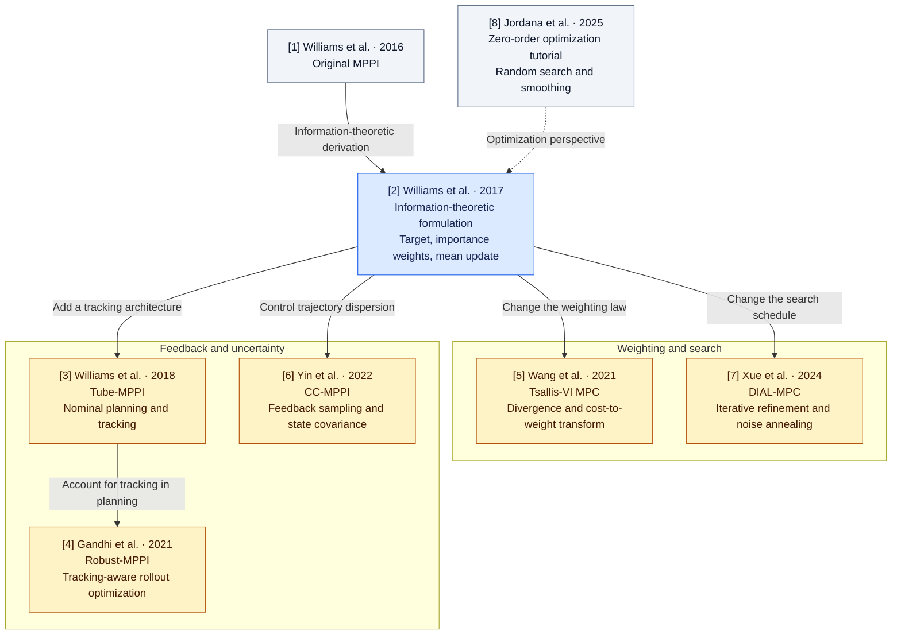

# MPPI Variant Playground

**A reproducible research playground for understanding *why* Model Predictive Path Integral (MPPI) controllers behave differently.**

MPPI plans by sampling control sequences, predicting their trajectories, and updating a nominal plan using cost-dependent weights. This repository studies how changes to the **sampling proposal** affect finite-sample estimates, selected controls, and closed-loop behavior. It connects mathematical derivations to controlled toy problems and a seven-state vehicle benchmark.

> **Scope.** The implemented controller is Gaussian information-theoretic MPPI (IT-MPPI) with several **fixed proposal covariance settings**. These are *not* implementations of separate published MPPI variants. Tsallis-VI, DIAL-MPC, Tube-MPPI, Robust-MPPI, and CC-MPPI remain future comparison targets.

## Formulations

The implemented baseline solves a distributional control problem: choose a distribution
$Q$ over latent control sequences that trades expected rollout cost against departure
from a fixed Gaussian base $P$:

$$
\min_Q\;\mathbb E_Q[J(Z)]+\lambda D_{\mathrm{KL}}(Q\Vert P),
\qquad
\pi^*(Z)=\eta^{-1}\exp[-J(Z)/\lambda]p(Z).
$$

Here $Z=(z_0,\ldots,z_{T-1})$, $J$ is the trajectory cost, $\lambda>0$ is temperature,
and $\eta$ normalizes the target. The base and sampling proposal are

$$
p(Z)=\prod_{t=0}^{T-1}\mathcal N(z_t;0,C_0),
\qquad
q_{U,C}(Z)=\prod_{t=0}^{T-1}\mathcal N(z_t;U_t,C).
$$

The base covariance $C_0$ defines part of the objective; the proposal mean $U$ and
covariance $C$ determine where samples are drawn. Projecting the target onto a
Gaussian with fixed covariance gives the ideal mean $U^*=\mathbb E_{\pi^*}[Z]$.
For $K$ samples $Z^{(k)}=U+\epsilon^{(k)}$ from the proposal, MPPI estimates it with

$$
L_k=-J(Z^{(k)})/\lambda+\log p(Z^{(k)})-\log q_{U,C}(Z^{(k)}),
\qquad
w_k=\frac{\exp(L_k-\max_j L_j)}{\sum_i\exp(L_i-\max_j L_j)},
$$

$$
U^+=\sum_{k=1}^{K}w_kZ^{(k)}
=U+\sum_{k=1}^{K}w_k\epsilon^{(k)}.
$$

The full Gaussian density correction is

$$
\log\frac{p(Z^{(k)})}{q_{U,C}(Z^{(k)})}
=-\frac12\sum_t\left[
(z_t^{(k)})^\top C_0^{-1}z_t^{(k)}
-(\epsilon_t^{(k)})^\top C^{-1}\epsilon_t^{(k)}
+\log\det C_0-\log\det C
\right].
$$

When $C=C_0$, this reduces, up to a sample-independent term, to
$-\sum_t U_t^\top C^{-1}\epsilon_t^{(k)}$. The familiar cross-term correction
therefore applies to that equal-covariance case; changing $C$ generally requires the
full ratio. Cost-only weights generally define a different target.

**What the current experiments vary.** With the state, warm start, base, cost and
temperature fixed, changing $C$ preserves the ideal target but changes the finite-sample
estimate. The main seven-state campaign uses $C_0=\operatorname{diag}(0.14,0.26)$,
$T=20$, $K=384$ and $\lambda=8$; budget studies vary $K$ separately.

| Proposal | Steering variance | Throttle variance | Cross-covariance | Latent trace |
| --- | ---: | ---: | ---: | ---: |
| Standard | 0.14 | 0.26 | 0 | 0.40 |
| Isotropic | 0.20 | 0.20 | 0 | 0.40 |
| Diagonal | 0.09 | 0.31 | 0 | 0.40 |
| Full | 0.14 | 0.26 | 0.07 | 0.40 |

These are fixed Gaussian proposal settings within one formulation. Equal trace matches
expected squared latent perturbation magnitude, not determinant, entropy, or physical
control dispersion after saturation. Q03 also examines sensitivity-aligned and
misaligned proposals; historical campaigns use separately recorded matrices.

**From a distribution to an applied command.** The seven-state model maps latent
controls to steering and signed throttle with
$u_t=\operatorname{clip}(\operatorname{diag}(0.5,1)z_t,\text{bounds})$.
Likelihoods are evaluated before clipping; the mapped controls determine rollout costs.
The controller applies the first mapped command, shifts the latent plan, and replans.
The separate command-slew study additionally limits steering changes using the previous
command. This changes the physical control distribution while retaining the latent
Gaussian density correction.

Finite self-normalized estimates can be biased and dominated by a few samples.
$\mathrm{ESS}=1/\sum_k w_k^2$ measures weight concentration; it does not certify
accurate target means or safe executed controls. The [full derivation](docs/formulations.md)
records numerical assumptions and the historical baseline settings.

## Paper map

The diagram connects the eight references used in this repository. Arrows indicate
conceptual reading connections, not a verified citation graph. Blue marks the implemented
baseline; amber marks planned formulations; gray marks historical or tutorial context.



| Reference | Mathematical feature to investigate | Repository status |
| --- | --- | --- |
| [1] [Williams et al., 2016 — original MPPI](https://doi.org/10.1109/ICRA.2016.7487277) | Path-integral sampling control; historical starting point. | Context; no equation-by-equation reproduction claimed. |
| [2] [Williams et al., 2017 — IT-MPPI](https://arxiv.org/html/1707.02342v1) | KL-regularized target, base/proposal importance ratio, and weighted mean projection. | Implemented finite-dimensional Gaussian baseline above. |
| [3] [Williams et al., 2018 — Tube-MPPI](https://www.roboticsproceedings.org/rss14/p42.pdf) | Separate nominal planning and ancillary tracking, including nominal reset logic. | Planned; requires an explicit tracking architecture. |
| [4] [Gandhi et al., 2021 — Robust-MPPI](https://arxiv.org/html/2102.09027v1) | Include tracking feedback in nominal/actual rollouts and the importance-sampling construction. | Planned; an environmental disturbance alone does not implement RMPPI. |
| [5] [Wang et al., 2021 — Tsallis-VI MPC](https://arxiv.org/html/2104.00241v1) | Change the distributional regularizer and cost-to-weight transform; fit the parameterized policy. | Planned; transform convention, support and scale require their own derivation. |
| [6] [Yin et al., 2022 — CC-MPPI](https://arxiv.org/html/2109.12147v3) | Linearize dynamics, design covariance-steering feedback, and sample with feedback under state-covariance constraints. | Planned; full control-proposal covariance alone is insufficient. |
| [7] [Xue et al., 2024 — DIAL-MPC](https://arxiv.org/html/2409.15610v1) | Refine samples iteratively with trajectory-wise and horizon-wise noise annealing. | Planned; count all inner-pass rollouts when comparing work. |
| [8] [Jordana et al., 2025 — zero-order optimization tutorial](https://arxiv.org/html/2506.22087v1) | Relate random search, smoothing and distribution optimization while distinguishing their objectives. | Conceptual context for interpreting sampling methods. |

Read [1] → [2] for the baseline derivation; [2] → [5] or [7] for weighting and
search; [2] → [3] → [4] for tracking; and [2] → [6] for state uncertainty.
Proposal control covariance, predicted state covariance and a prescribed covariance
bound are different objects. CEM is another planned optimizer—elite selection and
mean/covariance refitting—with no separate paper in this eight-reference set.
The [source notes](docs/paper_map.md#source-map-and-verified-equation-locations)
record reviewed versions, equation locations and access limitations.

## Start here

- **Understand the math:** [Formulations](docs/formulations.md) · [Paper map](docs/paper_map.md)
- **Browse the evidence:** [Research question index](docs/research_index.md) · [Machine-readable registry](results/registry.yaml)
- **Reproduce an experiment:** [Q03 frozen-state decisions](docs/questions/Q03_frozen_decision.md) · [Q05 S-turn difficulty](docs/questions/Q05_s_turn_difficulty.md)
- **Audit the model and findings:** [Seven-state scientific report](docs/seven_state_benchmark_report.md) · [Implementation fidelity](docs/implementation_fidelity.md)

## The central question

**If several controllers seek the same MPPI target distribution, when—and why—does the way they sample controls change their decisions?**

A proposal covariance can alter which trajectories are sampled and how concentrated the importance weights become, without changing the ideal target distribution. We test that distinction at three scales:

1. **Analytic:** compare an estimator to a known Gaussian target.
2. **Decision-level:** freeze the physical state and nominal control sequence, then compare MPPI updates.
3. **Closed-loop:** execute the same vehicle tasks across paired random seeds and increasing difficulty.

## Research questions and key figures

Each completed question has **one primary figure** below. Follow its link for complete methods, uncertainty, negative results, configurations, and reproduction commands. The figures summarize evidence; they do not replace the run records.

### Q01 · Does covariance geometry improve finite-sample estimation?


For a **fixed, analytically solvable Gaussian target**, proposal orientation can help *or* hurt. At $K=256$ with 64 independent replication seeds, observed mean squared error was **0.003646** for the +45° full proposal, **0.006505** for isotropic, and **0.065524** for the −45° full proposal. These results concern estimation, **not vehicle performance**. [Experiment Q01](docs/questions/Q01_sampling_accuracy.md).

### Q02 · What makes importance weights concentrate?


Temperature and high-dimensional proposal mismatch can concentrate weights by different mechanisms. Effective sample size (ESS) is an overlap diagnostic, **not a guarantee of estimator accuracy**; changing temperature also changes the target. [Experiment Q02](docs/questions/Q02_weight_degeneracy.md).

### Q03 · How does sampling geometry change one MPPI decision?


At an identical seven-state vehicle observation and warm start, different proposal covariances produce different sampled trajectories, corrected weights, and updated controls. The high-sample target reference is **unresolved** for the open-space and pre-obstacle decisions; only the post-disturbance reference passes the stated diagnostic screens. The pre-obstacle reference's pooled ESS is just **1.51 despite 524,288 samples**. [Experiment Q03](docs/questions/Q03_frozen_decision.md).

### Q04 · Do decision differences persist in closed-loop driving?


The seven-state study recorded **391 completions in 400 independent holdout episodes** across five scenarios. Completion is often nearly saturated, but route selection can differ: in the two-route task, the full proposal selected the upper route in **17/20** holdout runs, versus **5/20** for standard and isotropic and **2/20** for diagonal. These are observations about specific covariance matrices, **not general rankings of MPPI families**. [Experiment Q04](docs/questions/Q04_closed_loop.md).

### Q05 · When does a more demanding S-turn expose limitations?


In the primary seven-state S-turn study ($K=384$, 20 paired holdout seeds per setting), **313/320 episodes completed**. At the tightest 0.20 m clearance, completions were 20/20 standard, 16/20 isotropic, 20/20 diagonal, and 19/20 full. All seven primary failures were terminal-state timeouts; there were zero disk-proxy collisions. Separate studies investigate command-slew limits, speed preference, state-jump disturbances and sample budgets; they are **not pooled** into the primary clearance results. [Experiment Q05](docs/questions/Q05_s_turn_difficulty.md).

### Q06 · What changes in the published MPPI variants?

**Planned; no comparative performance results yet.** The [paper map](docs/paper_map.md) organizes work on divergence/weighting (Tsallis), annealing (DIAL), tracking and robustness (Tube/RMPPI), and state covariance/feedback (CC-MPPI). These require faithful, distinct implementations before cross-method performance claims. [Experiment plan Q06](docs/questions/Q06_variant_formulations.md).

## Dynamics and controls

| Model | States | Physical control input | Role |
| --- | --- | --- | --- |
| Kinematic bicycle | 4 | acceleration, steering angle | Historical baseline |
| Steering-rate bicycle | 5 | acceleration, steering rate | Historical S-turn study |
| Dynamic single-track vehicle | 7 | steering angle, signed normalized throttle | Main Q03–Q05 campaign |

The primary vehicle state is $[p_x,p_y,\psi,\phi,v_x,v_y,r]$: global position, heading, roll, body-frame longitudinal/lateral velocity and yaw rate. Its physics model includes tire-force saturation, planar body dynamics and an overdamped roll state. It is **not** the learned AutoRally model from Williams et al. The control-sequence sampling dimension is $2T$, **not seven**; the main vehicle campaign uses $T=20$ and therefore a 40-dimensional latent control sequence. [Model equations and validation](docs/seven_state_benchmark_report.md).

## Run and reproduce

Requirements: Linux, Python 3.11+, [`uv`](https://docs.astral.sh/uv/). The benchmark is CPU-oriented; no GPU is required.

```bash
uv sync --frozen
export OPENBLAS_NUM_THREADS=1 OMP_NUM_THREADS=1 MPLBACKEND=Agg
uv run ruff check .
uv run ruff format --check .
uv run pytest
uv run python experiments/research_index.py
```

Rebuild the Q03 visualization from **already saved** numerical records, without running the controller again:

```bash
uv run python experiments/plot_seven_state.py \
  --stage Q03 \
  --input runs/seven_state/Q03/seven_state_q03_v1
```

For fresh simulation runs, use each question's **Reproduce and regenerate** section rather than overwriting completed run IDs. See the [research index](docs/research_index.md) for all experiments.

### Repository map

```text
configs/                 Controllers, costs, dynamics and scenarios
src/                     MPPI, dynamics, sampling, evaluation and analysis
experiments/             Simulation and saved-data reconstruction entry points
docs/questions/          One research question per document
results/showcase/        Exactly one curated key image per executed question
results/registry.yaml    Experiments, claims, run IDs and provenance
runs/seven_state/Qxx/     Question-specific summaries/configs and local raw data
tests/                   Numerical and reproducibility checks
```

Full episode trajectories and rollout arrays are not all version-controlled. **A fresh clone includes curated figures and compact evidence, but not every raw rollout.** Rerun the question-specific commands to regenerate omitted data. See [storage and provenance](docs/research_index.md#storage-and-provenance).

## How to interpret the results

These experiments are **diagnostic, not a leaderboard**.

- The compared covariance matrices are fixed choices within one IT-MPPI implementation. Their performance does not establish universal superiority of isotropic, diagonal, or full covariance.
- Q01–Q02's analytic studies are **vehicle-independent**; Q03–Q05 use the seven-state physics approximation.
- A high ESS, low sampled cost, or visually broad rollout cloud does not by itself establish a good or safe executed control decision. Two Q03 reference estimates remain unresolved.
- Reported collision counts use a **centered disk proxy**, not a full-vehicle collision certificate. The S-turn reference has an additional capsule check, but the complete executed campaigns do not establish full-body safety.
- Q05's primary success criterion allows terminal runout/recovery; it is not a stopped-point parking test. Secondary exogenous state jumps can directly cause boundary violations and are analyzed separately.
- Equal-$K$ experiments are **not equal-wall-clock comparisons**. In isolated S-turn timing probes, $K=384$ took roughly 191–198 ms per plan, longer than the 150 ms simulation control interval. This implementation has not demonstrated a real-time deadline guarantee.

For equations, seed protocols, detailed failure cases, uncertainty, and limitations, read the [full seven-state report](docs/seven_state_benchmark_report.md).

## Reading and attribution

The starting point is Williams et al., [*Information Theoretic Model Predictive Control: Theory and Applications to Autonomous Driving*](https://arxiv.org/abs/1707.02342). The [paper map](docs/paper_map.md) records the other MPPI families and how their formulations differ. This repository is an independent educational/research implementation, not an official implementation of those papers.

## Published-formulation implementation audit

Work proceeds on `mppi-formulation-comparison`; the Q01–Q05 evidence above remains
unchanged. The following audit fixes the defining mechanisms before new implementation.
All methods retain the existing seven-state plant, normalization, geometry and finish rules.

| Controller / source | Objective and sampling | Weights and update | Feedback, model information, assumptions | Equation anchors |
| --- | --- | --- | --- | --- |
| IT-MPPI | Fixed-base KL-regularized expected cost; independent Gaussian latent proposals. | Exponential cost likelihood times full base/proposal ratio; weighted mean. | Deterministic nonlinear model; positive-definite covariance and finite moments. No ancillary tracker. | Williams 2017 (14), (20)–(22). |
| Tsallis-VI | Expected cost plus Tsallis divergence; Gaussian policy projection. | Paper-convention deformed likelihood with support cutoff; importance-corrected mean fit with fixed covariance (Table II). | Same model; declare transformed scale separately from objective multiplier. Covariance fitting is a distinct optional policy class. | Wang 2021 (6), (8)–(11), (14), (28), Table II. |
| DIAL-MPC | Cost-based smoothed optimization; repeated Gaussian perturbations with iteration and horizon annealing. | Cost-only exponential weights; weighted perturbation update at every inner pass. | Nonlinear model; shifted warm start. Its changing smoothing objective differs from the baseline fixed-base target. | Xue 2024 (1)–(7), Algorithm 1. |
| Tube-MPPI | Nominal and observed-state MPPI optimizations with a separate trajectory tracker. | MPPI updates and free-energy-based nominal reset selection. | Nominal/actual separation; local tracking design needs linearization and explicit operating limits. | Williams 2018 (9)–(10), tube-control architecture; Gandhi 2021 §III Tube-MPPI description. |
| Robust-MPPI | Coupled nominal/actual rollouts; mixed nominal cost and feedback-aware actual cost. | Separate real and nominal exponential updates; feasible nominal-state candidate selection. | Feedback enters prediction and likelihood correction. Contraction and free-energy guarantees require assumptions beyond local tracking. | Gandhi 2021 (7)–(11), Algorithms 1–3. |
| CC-MPPI | Linearized covariance-steering subproblem; Gaussian disturbances plus auxiliary-noise feedback. | Constrained quadratic gain design, feedback-shaped nonlinear samples, weighted control fit. | Dynamics Jacobians, declared input-noise covariance, PSD terminal state bound; linear feasibility does not certify nonlinear clipped covariance. | Yin 2022 (7)–(21), Algorithm 1. |

The source links and reviewed versions are in the paper table above. New variants
remain **PLANNED** until mathematical tests and seven-state execution pass. No V01–V06
benchmark is yet claimed executed. The baseline oracle in
`tests/fixtures/it_mppi_before_variants.json` records three sequential decisions in
open space, disturbance and S-turn scenes from commit `c7bbf86` before controller changes.
