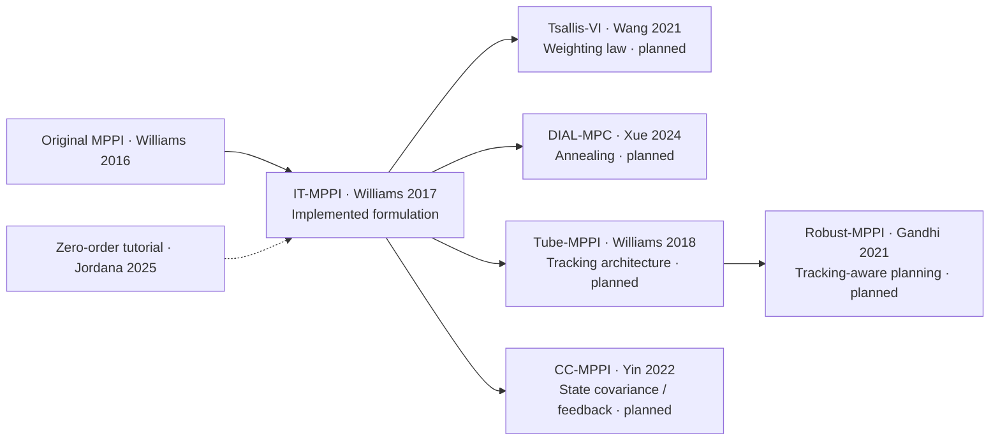

# MPPI Variant Playground

A research companion for understanding MPPI formulations through their mathematics,
finite-sample decisions and control behavior. Follow a scientific question from hypothesis
to reproducible evidence, including negative results and unresolved estimates.

## The MPPI formulation

MPPI samples control sequences, predicts trajectories, scores them, updates a nominal
sequence and executes its first command. The implemented Gaussian IT-MPPI uses

$$p(Z)=\prod_t\mathcal N(z_t;0,C_0),\quad q_U(Z)=\prod_t\mathcal N(z_t;U_t,C),$$
$$\pi(Z)\propto e^{-J(Z)/\lambda}p(Z),\qquad w_k\propto
e^{-J(Z_k)/\lambda}p(Z_k)/q_U(Z_k),\qquad U^+=\sum_k w_kZ_k.$$

The base stays fixed when proposal covariance changes. Densities use normalized latent
controls, weights are normalized in log space, and physical limits apply inside
prediction. Finite self-normalized estimates can be weight-degenerate. See the
[derivation](docs/formulations.md).

## Paper formulation map



Arrows are conceptual reading connections. [Eight papers, equation locations and source
versions](docs/paper_map.md) separate paper-level claims from the implementation and
experimentally verified claims.

## Research Questions and Key Results

[Research index](docs/research_index.md) · [Registry](results/registry.yaml) · [Historical
evidence](results/archive/legacy_index.md)


### Q01 — Sampling covariance and estimation accuracy


**Finding:** At K=256 in the declared quadratic case, MSE is 0.007657 for isotropic, 0.003699 for +45° anisotropy and 0.049254 for −45°. Geometry helps or hurts depending on alignment.

**Interpretation:** A common Gaussian Gibbs target separates proposal-induced finite-sample error from a changed optimization problem. ESS alone does not determine mean-estimation variance.

**Limitations:** An exact quadratic target is not a vehicle task. Trace matching does not match determinant; one matrix cannot represent a covariance family.

- [Detailed experiment](docs/questions/Q01_sampling_accuracy.md)
- [Original configuration](results/investigations/gaussian_v1/config.yaml)
- [Data summary](results/investigations/gaussian_v1/summary.csv)
- [Reproduction commands](docs/questions/Q01_sampling_accuracy.md#reproduce-and-regenerate)

### Q02 — Importance-weight concentration


**Finding:** In the isotropic K=512 slice, mean ESS rises from 41.95 at λ=.1 to 453.29 at λ=10 while mean error is nonmonotonic. Separate dimension probes isolate cost and density-ratio concentration.

**Interpretation:** ESS summarizes normalized weights. Temperature changes the target; density ratios alone can concentrate in high dimensions.

**Limitations:** This is not a fixed-target temperature accuracy ranking or a causal diagnosis of every vehicle failure. Finite ESS does not certify population overlap.

- [Detailed experiment](docs/questions/Q02_weight_degeneracy.md)
- [Original configuration](results/investigations/temperature_v1/config.yaml)
- [Data summary](results/investigations/temperature_v1/summary.csv)
- [Reproduction commands](docs/questions/Q02_weight_degeneracy.md#reproduce-and-regenerate)

### Q03 — Frozen-state MPPI decision analysis


**Finding:** 7,200 decisions isolate covariance at common frozen inputs. High-sample reference ESS is only 1.10–2.19 from 524,288 rollouts per state; all three reference means remain unresolved.

**Interpretation:** Proposal geometry changes finite sampled rollouts, corrected weights, controls and open-loop predictions, even with the same target.

**Limitations:** Distances to unresolved references are not validated target-mean errors. Three states, one warm start per state and pointwise intervals do not establish general superiority.

- [Detailed experiment](docs/questions/Q03_frozen_decision.md)
- [Original configuration](results/investigations/frozen_decision_v1/config.yaml)
- [Data summary](results/investigations/frozen_decision_v1/summary.csv)
- [Reproduction commands](docs/questions/Q03_frozen_decision.md#reproduce-and-regenerate)

### Q04 — Closed-loop trajectory differences


**Finding:** The full setting takes 3 upper and 17 lower station crossings in the two-route task; others take 20 lower. Its aligned mean path has −0.206 m clearance despite collision-free individual executions.

**Interpretation:** Executed bundles, occupancy, local rollout clouds and inter-seed dispersion describe different distributions. A mean over routes need not be feasible.

**Limitations:** States and warm starts differ across closed-loop variants. Twenty seeds and one matrix per structure do not isolate covariance as the sole cause of route choice.

- [Detailed experiment](docs/questions/Q04_closed_loop.md)
- [Original configuration](results/investigations/trajectory_behavior_v1/config.yaml)
- [Data summary](results/investigations/trajectory_behavior_v1/behavior_summary.csv)
- [Reproduction commands](docs/questions/Q04_closed_loop.md#reproduce-and-regenerate)

### Q05 — S-turn difficulty and controller limitations


**Finding:** At .20 m clearance, completion is 17/20 standard, 18/20 isotropic and 20/20 diagonal/full. All 17 failures among 480 episodes are timeouts near the finish, with zero collisions.

**Interpretation:** A larger observed completion gap at the tightest clearance coexists with terminal speed/heading failures; this does not isolate covariance-driven route discovery.

**Limitations:** Twenty seeds give broad paired intervals. The difficulty threshold is unresolved; finish-region recovery, one corridor handedness, one horizon and specific matrices limit generalization.

- [Detailed experiment](docs/questions/Q05_s_turn_difficulty.md)
- [Original configuration](runs/Q05/s_turn_clearance_v1/config.yaml)
- [Data summary](runs/Q05/s_turn_clearance_v1/summary.csv)
- [Reproduction commands](docs/questions/Q05_s_turn_difficulty.md#reproduce-and-regenerate)

### Q06 — Published MPPI formulation comparisons

**PLANNED — no executed result or figure.**

**Finding:** PLANNED — CEM, Tsallis-VI, DIAL, Tube-MPPI, Robust-MPPI and CC-MPPI are not implemented or evaluated.

**Interpretation:** Paper-level changes to weighting, annealing, feedback and state-covariance design require distinct implementations and appropriate isolated tests.

**Limitations:** No experimental claims or placeholder figures. Covariance ablations are not these published formulations.

- [Detailed experiment](docs/questions/Q06_variant_formulations.md)
- [Original configuration](configs/investigations/published_formulations_plan.yaml)
- [Reproduction commands](docs/questions/Q06_variant_formulations.md#reproduce-and-regenerate)

## Current implementation status

Standard, isotropic, diagonal and full are covariance settings of one IT-MPPI
implementation. The original four-state acceleration/steering bicycle remains available.
The S-turn study adds a separate five-state acceleration/steering-rate bicycle and newly
declared normalized covariances; see [Q05](docs/questions/Q05_s_turn_difficulty.md) for
its execution status.

CEM, Tsallis-VI, DIAL-MPC, Tube-MPPI, Robust-MPPI and CC-MPPI remain **PLANNED**.
Covariance ablations are not those published formulations. See [implementation
fidelity](docs/implementation_fidelity.md) and [limitations](docs/limitations.md).

## Reproduction

Linux, Python 3.11+ and uv; CPU NumPy, no GPU required.

```bash
uv sync --frozen
export OPENBLAS_NUM_THREADS=1 OMP_NUM_THREADS=1 MPLBACKEND=Agg
uv run ruff check .
uv run ruff format --check .
uv run pytest
uv run python experiments/research_index.py
```

Use a fresh `runs/Qxx/<run_id>` directory for execution. Use saved data and `--plots-only`
to reconstruct figures. Historical `results/` directories retain their original records.
No new bulk binary archive is committed.

```text
configs/       Declared models, costs, controllers and experiment designs
src/           Shared MPPI, sampling, dynamics, geometry and analysis
experiments/   Execution, reconstruction and registry validation CLIs
docs/          Question documents, derivations, paper map and findings
results/       Registry, curated showcase and preserved historical evidence
runs/Qxx/      Raw new records and relative references to historical runs
tests/         Numerical, physical and evidence-consistency checks
```
