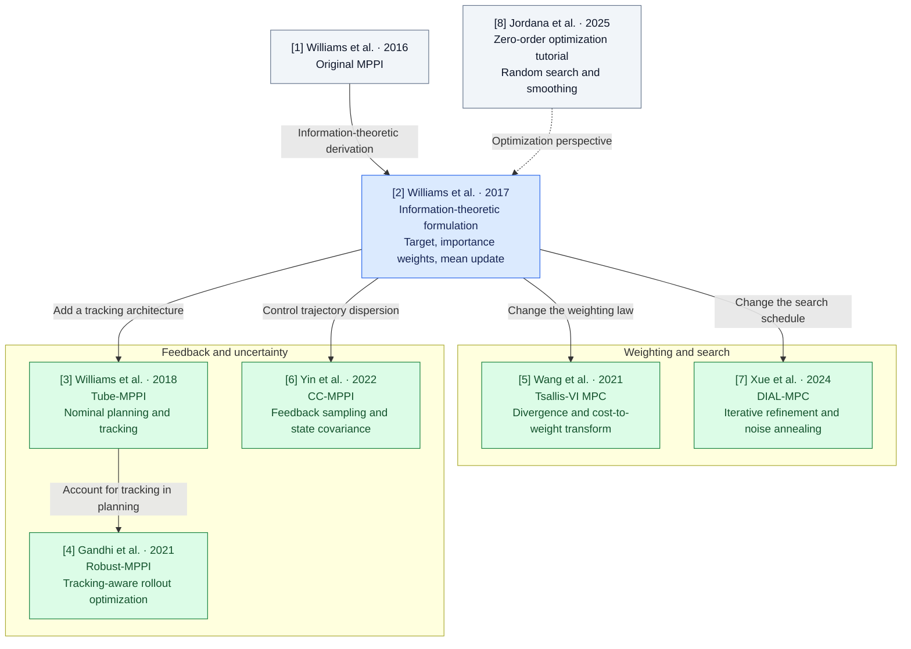

# MPPI Variant Playground

A reproducible research repository for understanding the mathematics and behavior of
**six MPPI formulations on one seven-state vehicle**: IT-MPPI, Tsallis-VI, DIAL-MPC,
Tube-MPPI, Robust-MPPI and CC-MPPI. The original covariance studies remain preserved.

## 1. Research motivation

The question is how a change in **objective, sampling, refinement, feedback, or state
uncertainty** changes a control decision. A covariance setting alone does not constitute
a new published algorithm. These experiments use distinct mathematical mechanisms,
common external task metrics, paired seeds, and separately stated internal objectives.

The implementations are CPU adaptations to this repository's vehicle, not reproductions
of the papers' hardware or headline performance. Tests establish specified numerical
properties; trajectories alone do not establish paper fidelity or theoretical guarantees.

## 2. Mathematical MPPI foundation

The implemented baseline solves a distributional control problem: choose a distribution
$Q$ over latent control sequences that trades expected rollout cost against departure
from a fixed Gaussian base $P$:

$$
\min_Q\;\mathbb E_Q[J(Z)]+\lambda D_{\mathrm{KL}}(Q\Vert P),
\qquad
\pi^*(Z)=\eta^{-1}\exp[-J(Z)/\lambda]p(Z).
$$

Here $Z=(z_0,\ldots,z_{T-1})$, $J$ is the trajectory cost, $\lambda>0$ is temperature,
and $\eta$ normalizes the target. The base and sampling proposal are

$$
p(Z)=\prod_{t=0}^{T-1}\mathcal N(z_t;0,C_0),
\qquad
q_{U,C}(Z)=\prod_{t=0}^{T-1}\mathcal N(z_t;U_t,C).
$$

The base covariance $C_0$ defines part of the objective; the proposal mean $U$ and
covariance $C$ determine where samples are drawn. Projecting the target onto a
Gaussian with fixed covariance gives the ideal mean $U^*=\mathbb E_{\pi^*}[Z]$.
For $K$ samples $Z^{(k)}=U+\epsilon^{(k)}$ from the proposal, MPPI estimates it with

$$
L_k=-J(Z^{(k)})/\lambda+\log p(Z^{(k)})-\log q_{U,C}(Z^{(k)}),
\qquad
w_k=\frac{\exp(L_k-\max_j L_j)}{\sum_i\exp(L_i-\max_j L_j)},
$$

$$
U^+=\sum_{k=1}^{K}w_kZ^{(k)}
=U+\sum_{k=1}^{K}w_k\epsilon^{(k)}.
$$

The full Gaussian density correction is

$$
\log\frac{p(Z^{(k)})}{q_{U,C}(Z^{(k)})}
=-\frac12\sum_t\left[
(z_t^{(k)})^\top C_0^{-1}z_t^{(k)}
-(\epsilon_t^{(k)})^\top C^{-1}\epsilon_t^{(k)}
+\log\det C_0-\log\det C
\right].
$$

When $C=C_0$, this reduces, up to a sample-independent term, to
$-\sum_t U_t^\top C^{-1}\epsilon_t^{(k)}$. The familiar cross-term correction
therefore applies to that equal-covariance case; changing $C$ generally requires the
full ratio. Cost-only weights generally define a different target.


The current IT-MPPI reference retains $C_0=C=\operatorname{diag}(0.14,0.26)$,
$\lambda=8$ and $T=20$. Its latent sequence has dimension $2T=40$.
Normalized inputs map to physical steering and throttle as
$u_t=\operatorname{clip}(\operatorname{diag}(0.5,1)z_t,\text{bounds})$.
Gaussian likelihoods precede clipping. The baseline applies the first updated command,
shifts the latent mean, and appends zero. Its behavior is checked against a saved
pre-implementation oracle from commit `c7bbf86`.

Changing only the proposal preserves the ideal fixed-base target but changes its
finite-sample estimate. The published formulations below can change the target itself.
Effective sample size $1/\sum_k w_k^2$ measures weight concentration; it is not an
accuracy, progress, or safety certificate.

## 3. Published formulation differences

| Method | Objective and sampling | Weight / update | Feedback and required information | Paper anchors |
| --- | --- | --- | --- | --- |
| IT-MPPI | Fixed-base KL objective; Gaussian control proposals. | Exponential cost likelihood with full $p/q$; weighted latent mean. | Nonlinear prediction model; no ancillary tracker. | Williams 2017 (14), (20)–(22). |
| Tsallis-VI | Tsallis divergence; fixed-covariance Gaussian policy class. | Truncated deformed likelihood with importance correction; weighted mean fit. | Nonlinear model; declared transformed scale and finite support. | Wang 2021 (6), (8)–(11), (14), (28), Table II. |
| DIAL-MPC | Iterated Gaussian-smoothed cost optimization. | Cost-only exponential weights at every annealing pass. | Nonlinear model; horizon and iteration noise schedules. | Xue 2024 (1)–(7), Algorithm 1. |
| Tube-MPPI | Separate nominal and observed-state plans. | Two IT-MPPI updates; solution-cost nominal reset rule. | Local trajectory tracker and dynamics Jacobians. | Williams 2018 Algorithms 1–2, §IV-C. |
| Robust-MPPI | Joint nominal/actual rollout objective and nominal-state search. | Separate mixed nominal and feedback-corrected actual weights. | Tracker inside prediction; Jacobians and candidate free-energy estimates. | Gandhi 2021 (7)–(11), Algorithms 1–3. |
| CC-MPPI | Covariance-steering quadratic subproblem and feedback-shaped sampling. | Augmented cost weights; fit shaped control sequences. | Jacobians, input-noise covariance, auxiliary noise state and terminal covariance bound. | Yin 2022 (3), (7)–(21), Algorithm 1. |

### Tsallis-VI: divergence and support

Using the paper's convention,

$$
D_r(Q\Vert P)=\frac{\int q(z)^r p(z)^{1-r}\,dz-1}{r-1},\qquad
\exp_r(x)=[1+(r-1)x]_+^{1/(r-1)},
$$

$$
q_r^*(Z)\propto p(Z)\exp_r[-J(Z)/\tilde\lambda],\qquad
w_k\propto\exp_r[-J_k/\tilde\lambda]\,p(Z_k)/q_{U,C}(Z_k).
$$

The transformed scale $\tilde\lambda$ is **not** the objective's regularization
multiplier. Holding it fixed gives the KL limit as $r\to1$. The executed setting
instead uses $r=1.5$, explicit batch cost normalization to $[0,1]$, and an 80th-percentile
cutoff $\gamma$, with $\tilde\lambda=(r-1)\gamma$. This adaptive scale changes the
decision objective. An empty support raises an error; it never becomes uniform weights.
The fixed-covariance Gaussian projection follows Table II; covariance fitting, mixtures
and Stein policies are not implemented.

### DIAL-MPC: iterative annealing

For inner pass $j=0,\ldots,I-1$ and horizon position $t=0,\ldots,T-1$,

$$
C_{j,t}=0.2I_2\exp\!\left[-\frac{j}{\beta_1 I}
-\frac{T-1-t}{\beta_2(T-1)}\right],\qquad
U\leftarrow U+\sum_k\operatorname{softmax}_k(-J/\lambda)\epsilon^{(k)}.
$$

The implementation uses four passes and $\beta_1=\beta_2=1$, with a separate
non-annealed ablation. Sampling uses the square root of the variance scale. The
cost-only law follows the paper's smoothing interpretation; it does not silently reuse
the baseline fixed-base importance weights. All passes and updated-plan rollouts count
toward work. The shifted warm start uses a zero tail.

### Tube-MPPI: nominal selection and tracking

Run MPPI from both the nominal state $\bar x$ and observation $x$. Select the actual-state
solution when its planned cost satisfies $S(U_x)\le S(U_{\bar x})+450$; otherwise retain
the nominal plan. Apply

$$u=\operatorname{clip}\bigl(u_{\rm nominal}+D K_0(x-\bar x),\text{bounds}\bigr).$$

The ancillary controller is a finite-horizon **local LQR adaptation**, rather than the
paper's iterative iLQG and asynchronous implementation. Central differences linearize
the same discrete plant in normalized input coordinates. A Riccati recursion uses
$Q=\operatorname{diag}(4,8,6,2,2,1,1)$, $R=I_2$, $Q_f=5Q$. No global tube bound or
stability claim is made across clipping kinks, large errors, or model mismatch.

### Robust-MPPI: feedback-aware planning

Nominal and actual rollouts share perturbations; actual rollouts additionally receive
$k_t=K_t(x_t-\bar x_t)$. At the implemented paper parameter $\beta=0$, define

$$
\widehat J_a=J_a+\frac\lambda2\sum_t k_t^\top C^{-1}k_t,
$$
$$
S_n=\tfrac12J_n+\tfrac12\max(\min(\widehat J_a,\alpha),J_n)
+\frac\lambda2\sum_t U_t^\top C^{-1}(U_t+2\epsilon_t),
$$
$$
S_a=J_a+\frac\lambda2\sum_t(U_t+k_t)^\top C^{-1}(U_t+k_t+2\epsilon_t).
$$

Nominal weights update the nominal plan; actual weights determine the executed first
command plus tracking. Five candidates interpolate previous nominal, propagated nominal,
and actual states. Eight probe samples estimate each candidate's free energy; choose the
nearest feasible candidate under $\alpha=5000$. If none qualifies, retain candidate zero
and log that event. The shared local LQR tracker is an adaptation. Contraction, recursive
feasibility and theoretical free-energy bounds are **not established** for this vehicle
and discontinuous task cost. Common physical effort/variation costs remain additional
task preferences beyond the paper's state-only notation.

### CC-MPPI: state covariance, not a full control covariance

For linearized dynamics $A_t,B_t$, auxiliary noise evolves independently of the
feedback-shaped physical trajectory:

$$
y_{t+1}=A_ty_t+B_t\epsilon_t,\quad y_0=0,\qquad
z_t=U_t+K_ty_t+\epsilon_t.
$$

Let $G=\mathcal B\bar\Sigma_\epsilon^{1/2}$ and
$F=(I+\mathcal B K)G$. The gain solve minimizes

$$\|\bar Q^{1/2}F\|_F^2+\|\bar R^{1/2}KG\|_F^2,
\qquad F_TF_T^\top\preceq\Sigma_f.$$

The code uses the feasible unconstrained quadratic solution when possible, otherwise
a Schur-complement SDP through CVXPY/Clarabel. A $10^{-10}$ numerical ridge is declared;
terminal PSD residual tolerance is $10^{-5}$. Infeasibility raises an explicit error.
The seven-state variance bound is $\operatorname{diag}(1,1,.25,.04,1,.5,.5)$.
Twenty percent of samples use zero nominal input, outside the controlled-population
bound. The paper's augmented quadratic cost uses $R=.01I_2$, noise ratio 100; the
weighted update includes feedback-shaped inputs and repeats the final tail input.
The auxiliary initial covariance is zero. A bound below the final additive-noise
floor can be infeasible; no fallback silently relaxes it. The bound concerns the
linearized sampling population, **not** full-body safety or
the executed closed-loop state distribution. Nonlinear empirical covariance is recorded
separately.

### Paper map

Arrows are conceptual reading connections. Blue is the baseline, green denotes
implemented seven-state adaptations, and gray gives historical/tutorial context.



| Ref. | Source used |
| --- | --- |
| [1] | [Williams et al., original MPPI, ICRA 2016](https://doi.org/10.1109/ICRA.2016.7487277). Historical context; no equation-level reproduction claimed. |
| [2] | [Williams et al., IT-MPPI, 1707.02342v1](https://arxiv.org/html/1707.02342v1). |
| [3] | [Williams et al., Tube-MPPI, RSS 2018](https://www.roboticsproceedings.org/rss14/p42.pdf). |
| [4] | [Gandhi et al., Robust-MPPI, 2102.09027v1](https://arxiv.org/html/2102.09027v1). |
| [5] | [Wang et al., Tsallis-VI MPC, 2104.00241v1](https://arxiv.org/html/2104.00241v1). |
| [6] | [Yin et al., CC-MPPI, 2109.12147v3](https://arxiv.org/html/2109.12147v3). |
| [7] | [Xue et al., DIAL-MPC, 2409.15610v1](https://arxiv.org/html/2409.15610v1). |
| [8] | [Jordana et al., zero-order optimization tutorial, 2506.22087v1](https://arxiv.org/html/2506.22087v1). Conceptual context. |

## 4. Seven-state dynamics

Every formulation uses the existing validated dynamic single-track model:

$$x=[p_x,p_y,\psi,\phi,v_x,v_y,r],\qquad u=[\delta,\tau].$$

The states are global position, heading, roll, body longitudinal/lateral velocity and
yaw rate; controls are steering angle and signed normalized throttle. Tire forces
saturate smoothly, body velocities are coupled, and roll obeys an overdamped torque
balance. Integration remains midpoint RK2 with three substeps per 0.15 s command interval.
Steering is bounded at ±0.5 rad, throttle at ±1, and forward speed at 0–4 m/s.

No vehicle parameters, state order, goal rules, geometry or cost implementation were
changed to favor a method. The plant omits reverse drive, full load transfer, roll
inertia/feedback and continuous steering-actuator dynamics. It is a physics approximation,
not the learned AutoRally model. The [validated equations and prior campaign](docs/seven_state_benchmark_report.md)
remain available. Collision checks retain the centered 0.22 m disk proxy, which does not
enclose the axles; full-body avoidance is not established.

V01–V04 retain the original deterministic execution plus declared scene disturbances.
V05–V06 add common independent Gaussian normalized actuator noise with covariance
$0.01C_0$, using `SeedSequence([4402, seed])`. All algorithms in those studies receive
the same realized noise stream. Noise is applied before the existing physical clipping;
the commanded and realized controls are recorded separately. CC sampling uses $C_0$,
100 times the execution-noise covariance, so its sampled dispersion is not a direct
prediction of executed closed-loop uncertainty.

## 5. Implementation status and mathematical validation

All six entries are **IMPLEMENTED seven-state adaptations**: defining mechanisms are
coded, mathematical checks pass, and recorded vehicle runs exist. The exact paper
hardware, tuning, theoretical guarantees and alternative policy classes are not claimed.

| Registry name | Implementation | Independent validation |
| --- | --- | --- |
| `it_mppi` | [Baseline](src/controllers/mppi.py) | Pre-change three-decision oracles for open, disturbance and S-turn scenes; full density correction. |
| `tsallis_vi` | [Tsallis](src/controllers/tsallis.py) | Analytically truncated weights; independently optimized discrete divergence problem; fixed-scale KL limit and reproducibility. |
| `dial_mpc` | [DIAL](src/controllers/dial.py) | Exact schedule; Gaussian tilted-mean integral; cost-only update and all-pass count. `dial_no_anneal` is an ablation. |
| `tube_mppi` | [Tube](src/controllers/tube.py) | Riccati gains versus independent batch least squares; plant derivatives; reset rejection and nonzero tracking test. |
| `robust_mppi` | [Robust](src/controllers/robust.py) | Feedback correction versus SciPy conditional Gaussian densities; mixed-cost clamp; feasible/infeasible candidate selection. |
| `cc_mppi` | [Covariance steering](src/controllers/covariance.py) | Analytic binding/inactive constrained optima; infeasible final-noise floor; Monte Carlo moments, symmetry/PSD, shaped mean fit. |

The [registry](src/controllers/registry.py) exposes one interface:
`reset(initial_state, seed)`, `command(observed_state)`, `get_diagnostics()`.
Controllers share the existing dynamics, costs, collision checker, episode recorder and
figure publisher. A wrapper counts actual calls to the plant; it does not implement a
second dynamics engine. Covariance and tracking states remain inside controllers.

## 6. V01–V06 experiments and computational protocols

| Study | Controlled comparison | Scenes | Executed episodes |
| --- | --- | --- | ---: |
| V01 | IT-MPPI / Tsallis weighting | Open, two-route obstacle | 24 |
| V02 | IT-MPPI / DIAL / non-annealed DIAL | Two-route obstacle, narrow passage | 36 |
| V03 | IT-MPPI / Tube tracking architecture | Disturbance, model mismatch | 24 |
| V04 | IT-MPPI / Robust augmented planning | Disturbance, model mismatch | 24 |
| V05 | IT-MPPI / CC state covariance | Open, narrow passage; shared stochastic actuation | 24 |
| V06 | All six formulations | Open, narrow, two-route, disturbance, mismatch, S-turn | 216 |

Each condition uses paired evaluation seeds **48000–48002**, horizon 20, the same
scene geometry, initial state, finish conditions, external task cost and 160-step episode
limit. S-turn clearance is 0.35 m. Three seeds give wide Wilson intervals; these are
exploratory mechanism studies, not general performance rankings. Repeated seeds and
conditions across stages/protocols are not independent replications.

**Dynamics-work protocol.** Every controller gets a ceiling of **7,700 predicted model
transitions per command**, including candidate searches, nominal rollouts, inner passes
and all finite-difference calls. Tube and DIAL use 7,680 due to integer allocation; the
remaining 20 are not filled with artificial work. Sampling settings are IT/Tsallis 384,
DIAL 95 per pass, Tube 182 per plan, Robust 159 per augmented pair plus candidate probes,
and CC 364. Each transition entails six RHS evaluations. Matrix factorization and solver
work are additionally reflected in planning time, rather than disguised as dynamics calls.

**Measured wall-clock protocol.** Independent calibration seeds 47900–47902 select
settings per algorithm and scenario. After warmup, the largest tested sample count with
90th-percentile time ≤120 ms is selected for a common **150 ms deadline**. V06 scans an
ascending grid until the first overrun; if no setting fits, it uses the minimum and records
violations. Calibration records are retained. This is a common calibrated ceiling, not
identical consumed runtimes or a hard real-time scheduler. V01's original grid ended at
384 and left substantial unused budget. Later grids extend to 3,072 samples.

Wall-clock episodes run serially. Work-budget episodes use eight workers; their timing
reflects concurrent load and is not used to claim comparative speed. The simulation keeps
its fixed control interval even after a deadline miss; delay-induced plant degradation is
not simulated. External metrics include completion, collision, goal error, cost, clearance,
effort, time and work. Internal weights, tracking and covariance metrics retain their
algorithm-specific meanings.

## 7. Key figures and verified findings

### V01 · Divergence and weighting


Both methods completed open space. In the two-route task, IT-MPPI completed 3/3 and this Tsallis setting 0/3 under both protocols, with no collisions. Higher Tsallis ESS accompanied stalled progress; it does not establish a better update. Batch normalization and the adaptive cutoff change the objective.

[Configuration](results/variants/V01_tsallis/config.yaml) · [Per-seed records](results/variants/V01_tsallis/per_seed.csv) · [Summary](results/variants/V01_tsallis/summary.csv) · [Audit](results/variants/V01_tsallis/audit.json) · [Fidelity and limitations](results/variants/V01_tsallis/findings.json)

### V02 · Refinement and annealing


All 36 episodes completed without collisions. Under the work ceiling, two-route mean external cost was 260.31 for IT-MPPI, 223.80 for DIAL, and 230.32 for the fixed-noise ablation. This is a small, specific-setting result; all inner work is included.

[Configuration](results/variants/V02_dial/config.yaml) · [Per-seed records](results/variants/V02_dial/per_seed.csv) · [Summary](results/variants/V02_dial/summary.csv) · [Audit](results/variants/V02_dial/audit.json) · [Fidelity and limitations](results/variants/V02_dial/findings.json)

### V03 · Tracking architecture


All 24 episodes completed without collisions. The actual-state plan was selected whenever discrepancies arose, and the recorded ancillary correction was zero throughout. The benchmark therefore does not demonstrate a tracking benefit; targeted tests separately exercise the active tracker.

[Configuration](results/variants/V03_tube/config.yaml) · [Per-seed records](results/variants/V03_tube/per_seed.csv) · [Summary](results/variants/V03_tube/summary.csv) · [Audit](results/variants/V03_tube/audit.json) · [Fidelity and limitations](results/variants/V03_tube/findings.json)

### V04 · Feedback-aware robustness


All work-budget episodes completed. In serial timing runs, Robust-MPPI completed 0/3 disturbance and 2/3 mismatch episodes, versus 3/3 for IT-MPPI in each. Candidate-search overhead left only 32 and 16 augmented samples respectively. The default candidate threshold selected the actual state, so these runs do not establish an active-feedback robustness benefit.

[Configuration](results/variants/V04_robust/config.yaml) · [Per-seed records](results/variants/V04_robust/per_seed.csv) · [Summary](results/variants/V04_robust/summary.csv) · [Audit](results/variants/V04_robust/audit.json) · [Fidelity and limitations](results/variants/V04_robust/findings.json)

### V05 · State uncertainty


All 24 episodes completed without collisions. The constrained linearized solutions passed their PSD bounds; no empirical controlled-population terminal covariance violations were observed. The nonlinear empirical covariance still differed from the prediction (mean Frobenius discrepancy roughly 0.27–0.29 in mixed state units). This does not certify executed trajectory safety.

[Configuration](results/variants/V05_covariance_steering/config.yaml) · [Per-seed records](results/variants/V05_covariance_steering/per_seed.csv) · [Summary](results/variants/V05_covariance_steering/summary.csv) · [Audit](results/variants/V05_covariance_steering/audit.json) · [Fidelity and limitations](results/variants/V05_covariance_steering/findings.json)
### V06 · Unified seven-state benchmark


Completion counts below are out of three seeds per scene. Entries show **work-budget /
wall-clock** results. The two values are distinct protocols, not pooled trials.

| Method | Open | Narrow | Two-route | Disturbance | Mismatch | S-turn |
| --- | ---: | ---: | ---: | ---: | ---: | ---: |
| IT-MPPI | 3 / 3 | 3 / 3 | 3 / 3 | 3 / 3 | 3 / 3 | 3 / 3 |
| Tsallis-VI | 3 / 3 | 3 / 3 | 0 / 0 | 3 / 3 | 3 / 3 | 0 / 0 |
| DIAL-MPC | 3 / 3 | 3 / 3 | 3 / 3 | 3 / 3 | 3 / 3 | 3 / 3 |
| Tube-MPPI | 3 / 3 | 3 / 3 | 2 / 3 | 3 / 3 | 3 / 3 | 3 / 2 |
| Robust-MPPI | 3 / 3 | 3 / 1 | 3 / 1 | 3 / 2 | 3 / 3 | 2 / 2 |
| CC-MPPI | 3 / 3 | 3 / 3 | 3 / 3 | 3 / 3 | 3 / 3 | 3 / 3 |

V06 recorded **195/216 completions**, **1 disk-proxy collision**,
and **20 timeouts** across its distinct conditions.
These totals describe execution coverage, not a pooled algorithm comparison. The audit
replayed all 216 episodes and checked 251 selected populations.

IT-MPPI, DIAL-MPC and CC-MPPI completed all 18 episodes in each protocol. This
Tsallis setting failed all two-route and S-turn episodes, including the single
collision. Costs include failures and timeouts and must be read with completion;
they are accumulated over episodes of different lengths.

The S-turn activated Tube tracking corrections and Robust sampled feedback under
both protocols. Tube corrections also appeared in serial narrow-passage runs.
Thus V03/V04's inactive tracking does not describe every V06 condition, but these
runs still do not isolate a causal tracking benefit. All CC local PSD bounds passed,
with no observed empirical controlled-population terminal covariance violations.

Serial command deadline misses were IT-MPPI **0/863**, Tsallis **0/1,463**, DIAL
**21/644 (3.26%)**, Tube **3/928 (0.32%)**, Robust **398/1,726 (23.06%)**, and CC
**5/855 (0.58%)**. These command-weighted fractions differ from averaging per-episode
fractions. The minimum calibration setting already exceeded the 120 ms target for
Robust in mismatch and S-turn, and DIAL in S-turn. Equal calibrated deadlines do
not imply equal delivered computation or that the deadline is achievable.

[Configuration](results/variants/V06_unified/config.yaml) ·
[Per-seed results](results/variants/V06_unified/per_seed.csv) ·
[Summary and intervals](results/variants/V06_unified/summary.csv) ·
[Command diagnostics](results/variants/V06_unified/diagnostics_summary.csv) ·
[Calibration](results/variants/V06_unified/calibration.csv) ·
[Audit](results/variants/V06_unified/audit.json) ·
[Findings and limitations](results/variants/V06_unified/findings.json)

### Preserved covariance studies

Q01–Q05 below are the earlier fixed-proposal studies, not published-formulation
comparisons. Their original configurations, manifests, figures and raw paths are retained.
The [historical registry](results/registry.yaml) and [question index](docs/research_index.md)
continue to describe that evidence.

### Q01 · Does covariance geometry improve finite-sample estimation?


For a **fixed, analytically solvable Gaussian target**, proposal orientation can help *or* hurt. At $K=256$ with 64 independent replication seeds, observed mean squared error was **0.003646** for the +45° full proposal, **0.006505** for isotropic, and **0.065524** for the −45° full proposal. These results concern estimation, **not vehicle performance**. [Experiment Q01](docs/questions/Q01_sampling_accuracy.md).

### Q02 · What makes importance weights concentrate?


Temperature and high-dimensional proposal mismatch can concentrate weights by different mechanisms. Effective sample size (ESS) is an overlap diagnostic, **not a guarantee of estimator accuracy**; changing temperature also changes the target. [Experiment Q02](docs/questions/Q02_weight_degeneracy.md).

### Q03 · How does sampling geometry change one MPPI decision?


At an identical seven-state vehicle observation and warm start, different proposal covariances produce different sampled trajectories, corrected weights, and updated controls. The high-sample target reference is **unresolved** for the open-space and pre-obstacle decisions; only the post-disturbance reference passes the stated diagnostic screens. The pre-obstacle reference's pooled ESS is just **1.51 despite 524,288 samples**. [Experiment Q03](docs/questions/Q03_frozen_decision.md).

### Q04 · Do decision differences persist in closed-loop driving?


The seven-state study recorded **391 completions in 400 independent holdout episodes** across five scenarios. Completion is often nearly saturated, but route selection can differ: in the two-route task, the full proposal selected the upper route in **17/20** holdout runs, versus **5/20** for standard and isotropic and **2/20** for diagonal. These are observations about specific covariance matrices, **not general rankings of MPPI families**. [Experiment Q04](docs/questions/Q04_closed_loop.md).

### Q05 · When does a more demanding S-turn expose limitations?


In the primary seven-state S-turn study ($K=384$, 20 paired holdout seeds per setting), **313/320 episodes completed**. At the tightest 0.20 m clearance, completions were 20/20 standard, 16/20 isotropic, 20/20 diagonal, and 19/20 full. All seven primary failures were terminal-state timeouts; there were zero disk-proxy collisions. Separate studies investigate command-slew limits, speed preference, state-jump disturbances and sample budgets; they are **not pooled** into the primary clearance results. [Experiment Q05](docs/questions/Q05_s_turn_difficulty.md).

### Q06 · Original published-formulation plan

The original Q06 plan is preserved as historical context. The new V01–V06 studies
below implement and evaluate six formulations; CEM remains planned. The historical
registry does not relabel covariance settings as published algorithms.


## 8. Reproduction instructions

Linux, Python 3.11+, `uv`; CPU NumPy/SciPy and CVXPY/Clarabel. No GPU is required.

```bash
uv sync --frozen
export OPENBLAS_NUM_THREADS=1 OMP_NUM_THREADS=1 MPLBACKEND=Agg MPLCONFIGDIR=.mpl-cache
uv run ruff check .
uv run ruff format --check .
uv run pytest
```

Run the stages individually, in order, with **fresh output and raw directories**:

```bash
uv run python experiments/variant_benchmark.py --study V01_tsallis \
  --output results/variants/V01_tsallis_reproduction --raw runs/variants/V01_tsallis_reproduction
uv run python experiments/variant_benchmark.py --study V02_dial \
  --output results/variants/V02_dial_reproduction --raw runs/variants/V02_dial_reproduction
uv run python experiments/variant_benchmark.py --study V03_tube \
  --output results/variants/V03_tube_reproduction --raw runs/variants/V03_tube_reproduction
uv run python experiments/variant_benchmark.py --study V04_robust \
  --output results/variants/V04_robust_reproduction --raw runs/variants/V04_robust_reproduction
uv run python experiments/variant_benchmark.py --study V05_covariance_steering \
  --output results/variants/V05_covariance_steering_reproduction --raw runs/variants/V05_covariance_steering_reproduction
uv run python experiments/variant_benchmark.py --study V06_unified \
  --output results/variants/V06_unified_reproduction --raw runs/variants/V06_unified_reproduction
```

The current config includes the final calibration policy. For exact historical protocol
reproduction, pass `--config results/variants/<study>/config.yaml`; the saved configuration
contains the original seeds, candidate grid and algorithm settings. Wall-clock calibration
is machine/load dependent and may select different sample counts on another machine.

Regenerate a figure from committed compact data, with no controller execution:

```bash
uv run python experiments/variant_benchmark.py --plot-only --output results/variants/V06_unified
```

Replay a completed run's ignored raw trajectories and selected populations:

```bash
uv run python experiments/audit_variants.py results/variants/V06_unified
uv run python experiments/summarize_variants.py results/variants/V06_unified
# After a fresh reproduction, substitute its output directory above.
```

Each study commits its config, manifest, per-seed and summary tables, primary figure,
interpretation and audit. Complete executed trajectories, command diagnostics and selected
rollout populations live under ignored `runs/variants/` directories. **A clone does not
include these raw files**; reproduce the simulations before running raw replay audits.
Every population is not stored at every decision; recorded seeds and configs permit
regeneration. No new result overwrites the historical Q01–Q05 evidence.

```text
src/controllers/        Explicit formulations, registry and shared feedback/accounting
src/dynamics/           Existing validated physical plant
src/costs/              Existing common external task objectives
src/analysis/           Shared runner, artifacts, figures and variant audit
configs/variants/       Frozen staged experiment settings
results/variants/       Compact V01–V06 evidence and one primary image per study
runs/variants/          Ignored executed trajectories and selected populations
tests/                  Mathematical references, invariants and baseline regression
```

## 9. Limitations and future work

- Three seeds per condition and one tuning per method cannot establish general rankings.
  Wider cohorts, parameter sensitivity, stronger tracking stress and additional covariance
  constraints are future experiments. Failed runs and inactive mechanisms are retained.
- Shared external scores do not imply identical distributional objectives. Tsallis changes
  the cost transform, DIAL changes smoothing, and feedback/covariance formulations add
  internal optimization. These differences are explicit, not treated as estimator errors
  against one shared target.
- Local LQR and finite-difference models have no proven global contraction or tube bound.
  Nominal candidate feasibility uses a small Monte Carlo estimate. Solver feasibility is
  a numerical property of the local CC subproblem, not a nonlinear safety certificate.
- Timing calibration is not a hard real-time guarantee. Solver/matrix work, candidate
  searches and extra passes can dominate. Missed deadlines are measured, but controller
  delay is not fed back into the simulated plant.
- Disk collision geometry, simplified roll, instantaneous steering, no reverse, terminal
  runout recovery and one S-turn handedness remain limitations of the shared benchmark.
- CEM, adaptive covariance/policy classes, contraction-metric trackers and hardware
  reproductions remain unimplemented. Existing historical source notes in
  [formulations](docs/formulations.md) and [paper map](docs/paper_map.md) are retained;
  the implementation status and new adaptation details are stated here.
