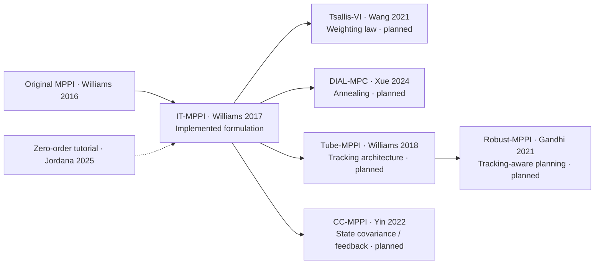
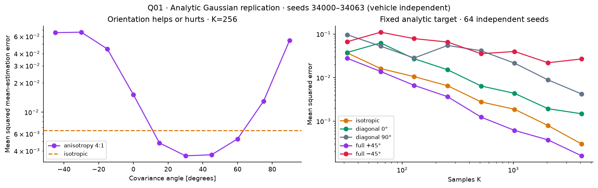
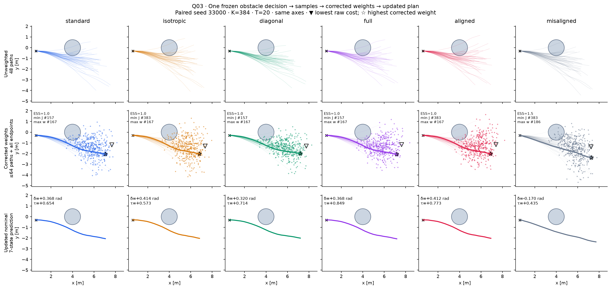
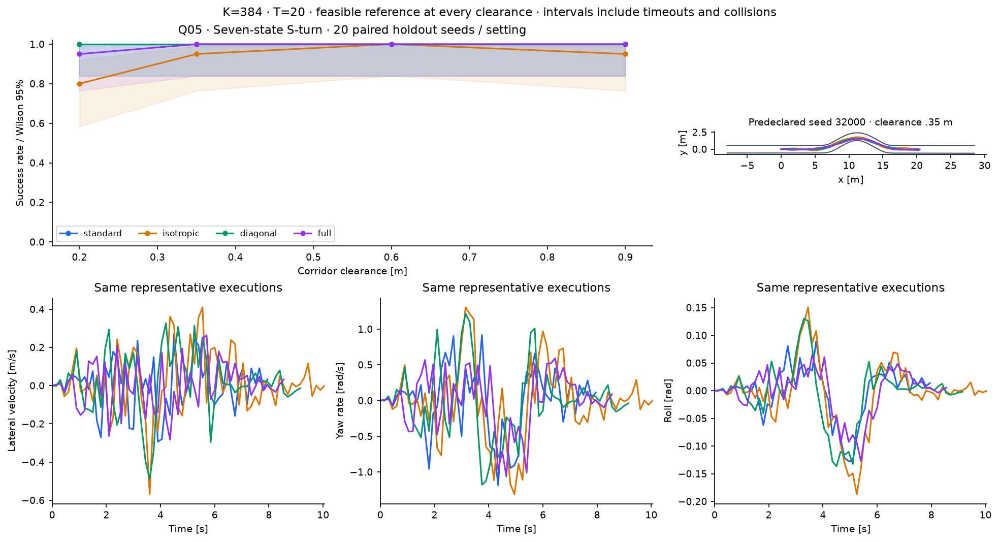

# MPPI Variant Playground

## Project objective

A research companion for understanding MPPI formulations through their mathematics,
finite-sample decisions and control behavior. Follow a scientific question from hypothesis
to reproducible evidence, including negative results and unresolved estimates.

## The MPPI formulation

MPPI samples control sequences, predicts trajectories, scores them, updates a nominal
sequence and executes its first command. The implemented Gaussian IT-MPPI uses

$$p(Z)=\prod_t\mathcal N(z_t;0,C_0),\quad q_U(Z)=\prod_t\mathcal N(z_t;U_t,C),$$
$$\pi(Z)\propto e^{-J(Z)/\lambda}p(Z),\qquad w_k\propto
e^{-J(Z_k)/\lambda}p(Z_k)/q_U(Z_k),\qquad U^+=\sum_k w_kZ_k.$$

The base stays fixed when proposal covariance changes. Densities use normalized latent
controls, weights are normalized in log space, and physical limits apply inside
prediction. Finite self-normalized estimates can be weight-degenerate. See the
[derivation](docs/formulations.md).

## Paper formulation map



Arrows are conceptual reading connections. [Eight papers, equation locations and source
versions](docs/paper_map.md) separate paper-level claims from the implementation and
experimentally verified claims.

## Implemented models

| Model | State dimension | Controls | Evidence |
| --- | --- | --- | --- |
| Kinematic bicycle | 4: x, y, yaw, speed | acceleration, steering | Historical baseline, retained |
| Steering-rate bicycle | 5 | acceleration, steering rate | Historical S-turn |
| Dynamic single-track | 7 | steering, signed throttle | Primary Q03–Q05 campaign |

The seven-state state is `[px,py,heading,roll,vx,vy,yaw_rate]` in SI units.
It uses saturating tire forces, body lateral/yaw dynamics and an explicit
first-order roll equation. It is a documented physics approximation, not the paper's learned
AutoRally model.
[Equations, validation and scientific report](docs/seven_state_benchmark_report.md).

## Research questions

Q01 and analytic Q02 are independent of vehicle dynamics. Q03–Q05 below use the seven-state
vehicle. Historical four/five-state evidence remains separately labeled in each question.
Q06 is a paper/formulation investigation with no implemented alternative algorithms.

## Key results

[Research index](docs/research_index.md) · [Registry](results/registry.yaml) · [Historical
evidence](results/archive/legacy_index.md)


### Q01 — Sampling covariance and estimation accuracy



**Finding:** An independent 64-seed replication preserves positive and negative orientation examples: at K=256, MSE is 0.006505 isotropic, 0.003646 at +45° and 0.065524 at −45°. These are estimates of one exact Gaussian target, not vehicle results.

**Interpretation:** A common Gaussian Gibbs target separates proposal-induced finite-sample error from a changed optimization problem. ESS alone does not determine mean-estimation variance.

**Limitations:** An exact quadratic target is not a vehicle task. Trace matching does not match determinant; empirical 64-seed variance and bias are finite-sample quantities.

- [Detailed experiment](docs/questions/Q01_sampling_accuracy.md)
- [Original configuration](runs/seven_state/Q01/seven_state_q01_v1/config.yaml)
- [Data summary](runs/seven_state/Q01/seven_state_q01_v1/summary.csv)
- [Reproduction commands](docs/questions/Q01_sampling_accuracy.md#reproduce-and-regenerate)

### Q02 — Importance-weight concentration


**Finding:** At K=512 the isotropic mean ESS grows from 40.56 at λ=.1 to 450.61 at λ=10, while mean error changes from .04284 to .05207 against each changed exact target. Cost-only, ratio-only and combined dimension probes separate concentration mechanisms.

**Interpretation:** ESS summarizes normalized weights. Temperature changes the target; density ratios alone can concentrate in high dimensions.

**Limitations:** Temperature changes the target. ESS does not certify estimation accuracy or target coverage. Seven states correspond to a 40-dimensional sampled control sequence here.

- [Detailed experiment](docs/questions/Q02_weight_degeneracy.md)
- [Original configuration](runs/seven_state/Q02/seven_state_q02_v1/config.yaml)
- [Data summary](runs/seven_state/Q02/seven_state_q02_v1/summary.csv)
- [Reproduction commands](docs/questions/Q02_weight_degeneracy.md#reproduce-and-regenerate)

### Q03 — Frozen-state MPPI decision analysis



**Finding:** 7,200 seven-state frozen decisions show finite-budget differences. Only the post-disturbance high-sample reference passes the declared diagnostics: standard RMS error drops .1085→.0140 from K=64→4096; sensitivity-aligned .2471→.1597. Open-space and obstacle references remain unresolved.

**Interpretation:** Proposal geometry changes finite sampled rollouts, corrected weights, controls and open-loop predictions, even with the same target.

**Limitations:** Two reference means fail overlap/precision diagnostics. Distances to those estimates are not validated target errors. Local sensitivity alignment is not target covariance matching; three states and one warm start each limit inference.

- [Detailed experiment](docs/questions/Q03_frozen_decision.md)
- [Original configuration](runs/seven_state/Q03/seven_state_q03_v1/config.yaml)
- [Data summary](runs/seven_state/Q03/seven_state_q03_v1/summary.csv)
- [Reproduction commands](docs/questions/Q03_frozen_decision.md#reproduce-and-regenerate)

### Q04 — Closed-loop trajectory differences


**Finding:** Across five seven-state scenes, compatibility completion is 397/400 and independent holdout completion 391/400, with zero collisions. In holdout two-route trials, full takes 17 upper routes out of 20; standard/isotropic take 5 and diagonal 2. Route frequencies characterize these matrices, not published algorithm families.

**Interpretation:** Executed bundles, occupancy, local rollout clouds and inter-seed dispersion describe different distributions. A mean over routes need not be feasible.

**Limitations:** Twenty seeds per scenario and cohort give wide intervals. Feedback changes state and warm start. Failures are terminal-region timeouts; one calibration and selected matrices cannot establish general superiority.

- [Detailed experiment](docs/questions/Q04_closed_loop.md)
- [Original configuration](runs/seven_state/Q04/seven_state_q04_v1/config.yaml)
- [Data summary](runs/seven_state/Q04/seven_state_q04_v1/summary.csv)
- [Reproduction commands](docs/questions/Q04_closed_loop.md#reproduce-and-regenerate)

### Q05 — S-turn difficulty and controller limitations



**Finding:** Seven-state S-turn completion: 0.9 m: standard 20/20, isotropic 19/20, diagonal 20/20, full 20/20; 0.6 m: standard 20/20, isotropic 20/20, diagonal 20/20, full 20/20; 0.35 m: standard 20/20, isotropic 19/20, diagonal 20/20, full 20/20; 0.2 m: standard 20/20, isotropic 16/20, diagonal 20/20, full 19/20. Across 320 primary episodes, 0 collisions; all failed trajectories are retained.

**Interpretation:** A larger observed completion gap at the tightest clearance coexists with terminal speed/heading failures; this does not isolate covariance-driven route discovery.

**Limitations:** One handedness, one horizon and specific matrices limit generalization. Completion allows straight-runout recovery. Intervals are pointwise. Steering-rate sweeps remain deferred; rate constraints need an augmented actuator/history model.

- [Detailed experiment](docs/questions/Q05_s_turn_difficulty.md)
- [Original configuration](runs/seven_state/Q05/seven_state_q05_v1/config.yaml)
- [Data summary](runs/seven_state/Q05/seven_state_q05_v1/summary.csv)
- [Reproduction commands](docs/questions/Q05_s_turn_difficulty.md#reproduce-and-regenerate)

### Q06 — Published MPPI formulation comparisons

**PLANNED — no executed result or figure.**

**Finding:** PLANNED — CEM, Tsallis-VI, DIAL, Tube-MPPI, Robust-MPPI and CC-MPPI are not implemented or evaluated.

**Interpretation:** Paper-level changes to weighting, annealing, feedback and state-covariance design require distinct implementations and appropriate isolated tests.

**Limitations:** No experimental claims or placeholder figures. Covariance ablations are not these published formulations.

- [Detailed experiment](docs/questions/Q06_variant_formulations.md)
- [Original configuration](configs/investigations/published_formulations_plan.yaml)
- [Reproduction commands](docs/questions/Q06_variant_formulations.md#reproduce-and-regenerate)

## Reproduction

Linux, Python 3.11+ and uv; CPU NumPy, no GPU required.

```bash
uv sync --frozen
export OPENBLAS_NUM_THREADS=1 OMP_NUM_THREADS=1 MPLBACKEND=Agg
uv run ruff check .
uv run ruff format --check .
uv run pytest
uv run python experiments/research_index.py
```

Use fresh run IDs for simulation; immutable completed directories are never overwritten.
Exact commands are in each question and the [report](docs/seven_state_benchmark_report.md).
The following rebuilds a figure from committed compact data without simulation:

```bash
uv run python experiments/plot_seven_state.py --stage Q03   --input runs/seven_state/Q03/seven_state_q03_v1
```

Full raw episodes and rollout NPZs are ignored local evidence. **Cloning does not contain
those raw records.** No LFS/external store is configured; rerun recorded commands to
recreate them. Small summaries, inputs, configs, manifests and selected figures are tracked.
Historical `results/investigations/` evidence is preserved.

```text
configs/       Declared models, costs, controllers and experiment designs
src/           Shared MPPI, sampling, dynamics, geometry and analysis
experiments/   Execution, reconstruction and registry validation CLIs
docs/          Question documents, derivations, paper map and findings
results/       Registry, curated showcase and preserved historical evidence
runs/seven_state/  Question-based new campaign records (bulk raw ignored)
tests/         Numerical, physical and evidence-consistency checks
```

## Limitations

These are covariance settings of one Gaussian IT-MPPI, not different published algorithms.
Specific matrices, one calibration, one S-turn handedness, one horizon and broad binomial
intervals limit generalization. ESS is not estimator accuracy. Two Q03 reference means
remain unresolved. The finish region allows runout recovery, not stopped-point parking.
The model omits load transfer, roll inertia/feedback and an actuator-rate state; it has
no reverse drive. Equal-K sweeps are not equal-wall-clock experiments or real-time guarantees.
See the [scientific report](docs/seven_state_benchmark_report.md) for failures, uncertainty
and the deferred steering-rate study.

