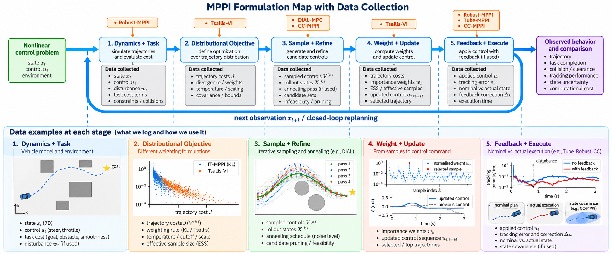
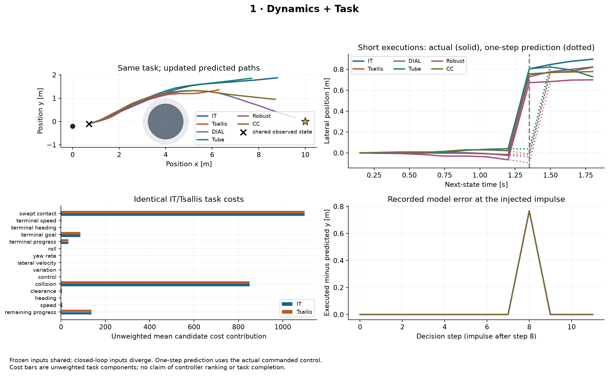
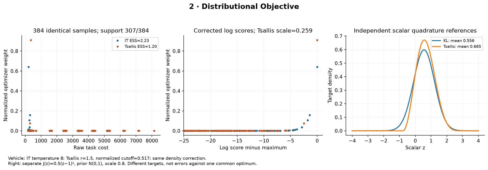
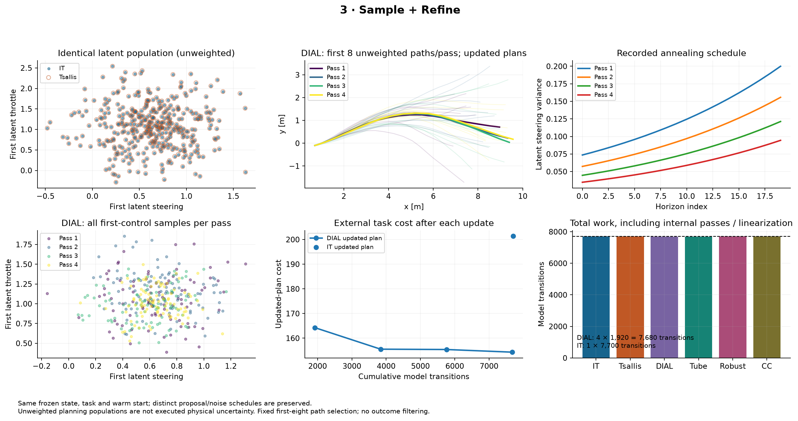
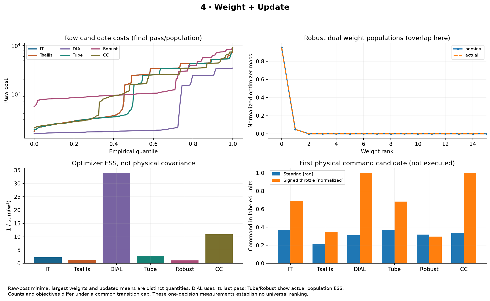
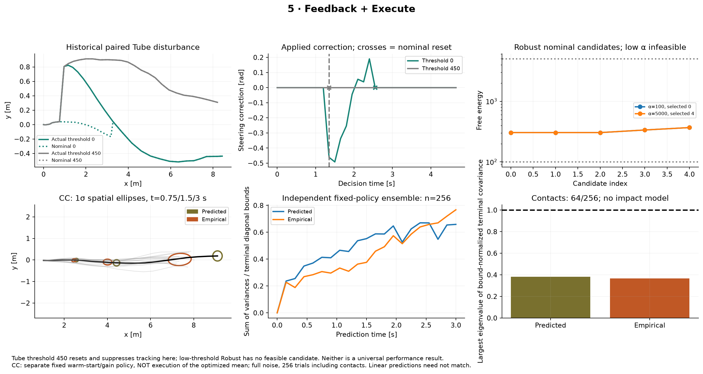

# MPPI Variant Playground

A research playground for studying how **six MPPI formulations** make control decisions for the same seven-state vehicle: IT-MPPI, Tsallis-VI, DIAL-MPC, Tube-MPPI, Robust-MPPI, and CC-MPPI. The earlier covariance-only experiments are preserved, but they are not the main comparison here.

## 1. Unified mathematical framework: where the variants intervene

The six formulations share a planning problem but **not necessarily the same variational objective**. We use common symbols to make their differences easier to follow; the equation below is a way to organize the methods, not an objective claimed by every paper.

| Symbol | Meaning |
|---|---|
| $x_t,\bar x_t$ | Actual and nominal physical state |
| $u_t,\bar u_t$ | Applied and nominal physical control |
| $Z=(z_0,\ldots,z_{H-1}),\bar Z$ | Sampled and nominal latent control sequences |
| $f,w_t,g$ | Dynamics, process disturbance, actuator transformation |
| $J(Z;\kappa)$ | Predicted finite-horizon cost under a feedback structure |
| $P,p$; $Q_\theta,q_\theta$ | Reference distribution and parameterized sampling distribution |
| $\mathcal R(Q,P),\lambda$ | Regularizer/divergence and its scale |
| $\mathcal A,\mathcal U$ | Sampling/refinement method and update operator |
| $\kappa_t,K_t$ | Ancillary feedback policy and optional linear gain |
| $\Sigma_t^x,\mathcal C_t$ | State covariance and its constraints |
| $N,H$ | Rollout count and prediction horizon |

A generalized research-level description is

$$
\begin{aligned}
\inf_{Q,\theta}\quad & \mathbb E_{Z\sim Q,W}\left[J(X(Z,W;\theta),Z)\right]
+\lambda\mathcal R(Q,P),\\
\text{subject to}\quad & X_{t+1}=f\bigl(X_t,g(z_t+\kappa_{\theta,t}(X_t,\bar X_t)),w_t\bigr),\\
&Q\in\mathcal Q,\quad \theta\in\Theta,\quad \mathcal C_t(\mathcal L(X_t))\le 0.
\end{aligned}
$$

For IT-MPPI, the regularizer is KL divergence and the ideal latent target is $\pi^*(Z)\propto p(Z)e^{-J(Z)/\lambda}$. Other methods can change the target itself, the search procedure, the tracking architecture, or restrictions on future state uncertainty.

### Formulation map: pipeline and data collection



*This is the existing formulation map, unchanged. The plots within it indicate where data are recorded; the actual measurements appear in Part 3.*

| Formulation | What changes | What to examine |
|---|---|---|
| **IT-MPPI** | KL objective, Gaussian proposals, importance-corrected mean update | Sampling accuracy and task cost |
| **Tsallis-VI** | Divergence, deformed weighting, finite support | Which samples matter and what control is selected |
| **DIAL-MPC** | Repeated refinement with changing sampling noise | Cost improvement per evaluation |
| **Tube-MPPI** | Nominal trajectory and ancillary tracker | Tracking after disturbances |
| **Robust-MPPI** | Nominal and actual trajectories enter planning together | Whether feedback is active and candidate search remains feasible |
| **CC-MPPI** | Covariance-steering feedback and state uncertainty constraints | Predicted and observed state dispersion |

In particular, changing the control proposal covariance $C$ does **not** amount to covariance steering. The proposal covariance, the predicted state covariance $\Sigma_t^x$, and a prescribed state covariance bound are three different things. The detailed equations and references are in Part 5.

---

## 2. Experimental setup

We run the controllers on a **seven-state dynamic single-track vehicle**. Its state and physical commands are

$$
x=[p_x,p_y,\psi,\phi,v_x,v_y,r],\qquad u=[\delta,\tau].
$$

The state contains position, heading, roll, forward and lateral body velocity, and yaw rate. The inputs are steering angle and signed throttle. The model includes saturating tire forces and an approximate roll response. The control period is 0.15 s, steering is limited to $\pm0.5$ rad, and throttle to $\pm1$. This is a physics-based test model, **not** the learned AutoRally model from the original IT-MPPI paper.

Each controller sees the same vehicle and external task definition within a matched comparison. Its *internal* objective or sampling procedure may differ, because that is what we are studying.

### Environments

| Setting | What happens | Why we use it |
|---|---|---|
| Open space | The vehicle drives toward a goal without nearby obstacles. | Check basic control behavior. |
| Narrow passage | The vehicle passes between obstacles. | Study limited clearance and feasible control sequences. |
| Two-route obstacle | The vehicle can pass an obstacle on either side. | Observe alternative routes, weighting, and local search. |
| S-turn | The vehicle follows a corridor with successive turns. | Test steering coordination and nonlinear dynamics. |
| Disturbance | The state is perturbed while driving. | Observe tracking corrections and recovery. |
| Model mismatch | Execution uses different dynamics from planning. | Test sensitivity to prediction errors. |

We use two complementary evaluation methods. **Closed-loop runs** show how the complete controller moves the vehicle. **Mechanism tests** hold relevant inputs fixed—often the vehicle state and warm-start controls—so we can examine what one mathematical change does to a decision. A separate stochastic experiment repeats one fixed policy with independent noise to study covariance steering.

The initial V01–V05 task comparisons use three paired seeds per condition, a prediction horizon of 20, and two budgets: a ceiling of about 7,700 model transitions per decision, and a separately calibrated 150 ms planning deadline. Equal rollout counts do not imply equal work: DIAL has multiple passes, while Tube, Robust, and CC-MPPI spend computation on feedback or covariance calculations. These experiments are exploratory, not a statistically reliable ranking.

### What is measured

We record candidate controls, predicted trajectories, costs, importance weights where relevant, updated nominal commands, tracking corrections, and executed states. The five figures below were generated from those **actual numerical records**. A frozen decision isolates internal computations; after different commands are executed, the vehicle states diverge and the comparison is no longer at an identical input.

---

## 3. Inside an MPPI decision

The formulation map in Part 1 shows *where* the papers intervene. Here we use measured results to understand what happens at each stage. The diagrams in Part 1 remain unchanged. The separate engineering coverage plot `pipeline_overview.png` is not shown because it describes logging completeness, not a scientific result.

### 3.1 Dynamics and task — what problem does the controller receive?



Every decision begins with an observed vehicle state, a task cost, and a prediction model. In the frozen-state test all controllers begin from the same observation. IT-MPPI and Tsallis also evaluate the same candidate controls, so their **unweighted costs agree**. This establishes that any difference in those two updates comes after trajectory scoring.

In a short closed-loop test, a lateral disturbance is introduced after decision 8. The figure shows the difference between predicted and observed states. From then on, each controller may visit different states. That is a meaningful control consequence, but no longer a same-input test.

### 3.2 Distributional objective — which samples should matter?



IT-MPPI gives a candidate an exponential cost score, with the appropriate base/proposal correction. Tsallis uses a deformed score and, in our implementation, a finite-support cutoff. Both are applied to **the same 384 candidate sequences** in this test. At the selected decision, the Tsallis cutoff retains 307 of them.

The scalar plot solves a different, deliberately simple problem where the reference distributions can be computed. It shows that KL and Tsallis need not seek the same distribution. The scalar optimum is **not** a ground-truth vehicle optimum. The vehicle Tsallis configuration also uses adaptive cost normalization and a cutoff, so its performance cannot be attributed to the divergence parameter alone.

### 3.3 Sample and refine — does another pass improve the plan?



IT-MPPI updates a plan from one population. DIAL repeats the sampling and update several times, changing the noise along the horizon and across passes. The figure records the actual populations, updated paths, and cumulative model work.

For this frozen decision, DIAL's updated-plan cost changed as follows:

| Pass | Updated-plan cost |
|---|---:|
| 1 | 164.28 |
| 2 | 155.55 |
| 3 | 155.42 |
| 4 | 154.34 |

The four passes used 7,680 predicted transitions. A single-pass IT-MPPI update using 7,700 transitions had cost 201.35 at this state. This is evidence that the *implemented refinement process* can change a decision. It does not yet isolate the effect of annealing from the effect of repeating optimization or using a different weighting convention.

### 3.4 Weight and update — what command comes out?



After scoring the candidates, the controller combines their control sequences. We compare IT-MPPI and Tsallis using identical candidates and costs:

| Measurement | IT-MPPI | Tsallis-VI |
|---|---:|---:|
| Effective sample size | 2.232 | 1.196 |
| Selected steering [rad] | 0.369 | 0.215 |
| Selected normalized throttle | 0.689 | 0.348 |

Both effective sample sizes are very small relative to 384 candidates. The weighting rules therefore produce different commands even though the samples were shared. This figure also distinguishes the lowest-cost sample, the highest-weight sample, and the updated mean; they do not have to coincide. **ESS measures weight concentration, not control quality or physical uncertainty.**

### 3.5 Feedback and execution — what happens after the plan is chosen?



Tube-MPPI tracks a nominal trajectory. In the targeted test, the default reset threshold left tracking inactive, whereas a stricter threshold allowed active corrections in some positive-disturbance runs. Robust-MPPI includes nominal and feedback-corrected trajectories during planning. Its default candidate selection also often left feedback inactive. A stricter threshold activated feedback but made the candidate search infeasible in the tested frozen cases. Those are **limitations of the tested settings**, not proof that feedback is ineffective.

CC-MPPI addresses a different question: can feedback reduce the spread of future states? In 256 independent narrow-passage executions with the larger noise setting, a fixed covariance-steered policy recorded **64 disk-proxy contacts**, compared with **183** for the zero-gain policy. The covariance was smaller, but collisions were not eliminated. These executions use a fixed feedback policy without receding-horizon replanning, so they test the covariance mechanism rather than full closed-loop CC-MPPI.

---

## 4. What the variants taught us

The five mechanism studies answer different questions. For that reason, we do not combine them into a single “best MPPI” ranking.

| Study | What we changed | What we observed | What remains open |
|---|---|---|---|
| **V01 — Tsallis-VI** | Divergence and weight transform | Different decisions from identical candidates; poor progress with the tested cutoff | Sensitivity to the divergence parameter, scale, and cutoff |
| **V02 — DIAL-MPC** | Repeated refinement and annealing | Updated-plan cost decreased in the selected decision | Does annealing help beyond repeated refinement? |
| **V03 — Tube-MPPI** | Nominal tracking and reset logic | Tracker often inactive at the default threshold | When does sustained tracking improve recovery? |
| **V04 — Robust-MPPI** | Feedback-aware augmented planning | Selection threshold controls activation and feasibility | Is there an active, feasible and useful operating regime? |
| **V05 — CC-MPPI** | State covariance steering | Reduced empirical dispersion and contacts in a fixed-policy test | How accurately does local covariance predict nonlinear closed-loop risk? |

### V01 — Divergence and weighting


The fixed-state experiment lets us compare weighting laws without changing the sampled paths. In the two-route closed-loop task, IT-MPPI reached the goal in 3/3 runs while the tested Tsallis configuration reached it in 0/3 under both original protocols. That is a negative result for *this configuration*, not a statement that Tsallis divergence is inferior in general.

[Watch the recorded two-route run](media/experiments/V01_tsallis.mp4).

### V02 — Iterative refinement and annealing


The separate annealed/non-annealed test is important: both DIAL versions improve the plan over repeated passes. In the selected recorded decision, the annealed version finished at approximately 154.19 cost and the fixed-noise version at 157.88. One decision is not enough to claim a consistent advantage, but it tells us what to investigate next.

[Watch the driving comparison](media/experiments/V02_dial.mp4) · [Watch the four inner passes](media/experiments/V02_dial_decision.mp4).

### V03 — Nominal tracking


A tracker that keeps resetting its nominal state to the observation can have little error left to correct. That is what we saw in most default-threshold trials. The targeted disturbance experiment is useful precisely because it records when tracking did, and did not, become active. We cannot yet claim a consistent disturbance-rejection benefit.

[Watch the recorded tracking experiment](media/experiments/V03_tube.mp4).

### V04 — Feedback-aware planning


In Robust-MPPI, the nominal-state choice affects what the controller predicts and which feedback corrections are used. The original threshold often selected the observed state, producing essentially the same update as the paired IT-MPPI comparison. A tighter threshold activated feedback but exhausted feasible candidate choices in the selected test. We have not yet found a setting that both activates the mechanism and demonstrates a robust improvement.

[Watch the recorded robust-control experiment](media/experiments/V04_robust.mp4).

### V05 — State covariance steering


The fixed-policy stochastic test gives the clearest physical effect: feedback reduced normalized terminal state dispersion and the number of disk-proxy contacts. However, the model's predicted covariance differed from the empirical nonlinear covariance, particularly at the larger noise level. A terminal covariance bound does not guarantee obstacle avoidance.

[Watch the stochastic execution ensemble](media/experiments/V05_covariance.mp4).

---

## 5. Mathematical formulations

This section records the equations underlying the comparison. The adaptations in this repository are not exact reproductions of the original papers' hardware implementations or theoretical guarantees.

### IT-MPPI: the reference controller

For a fixed base distribution $P$ over latent control sequences, the information-theoretic objective is

$$
\min_Q\;\mathbb E_Q[J(Z)]+\lambda D_{\mathrm{KL}}(Q\|P),
\qquad \pi^*(Z)=\eta^{-1}e^{-J(Z)/\lambda}p(Z).
$$

With $p(Z)=\prod_t\mathcal N(z_t;0,C_0)$ and $q_{U,C}(Z)=\prod_t\mathcal N(z_t;U_t,C)$, the importance-corrected weights and mean update are

$$
\ell_k=-J(Z^{(k)})/\lambda+\log p(Z^{(k)})-\log q_{U,C}(Z^{(k)}),\qquad
w_k=\frac{e^{\ell_k-\ell_{\max}}}{\sum_j e^{\ell_j-\ell_{\max}}},
$$

$$U^+=\sum_k w_k Z^{(k)}.$$

The baseline uses $C_0=C=\mathrm{diag}(0.14,0.26)$, $\lambda=8$ and a horizon of 20. The 7-state vehicle has **2 control inputs**, so the nominal latent control sequence has 40 coordinates. Likelihoods are evaluated before actuator clipping.

### Tsallis-VI: replacing the regularizer

One convention for Tsallis divergence and the deformed exponential is

$$
D_r(Q\|P)=\frac{\int q(z)^r p(z)^{1-r}\,dz-1}{r-1},\qquad
\exp_r(a)=[1+(r-1)a]_+^{1/(r-1)}.
$$

The resulting target has the form $q_r^*(Z)\propto p(Z)\exp_r[-J(Z)/\widetilde\lambda]$ under the selected convention. Our vehicle adaptation uses $r=1.5$, batch cost normalization, and an adaptive cutoff. The transformed scale $\widetilde\lambda$ must not be confused with the original KL regularization multiplier.

### DIAL-MPC: repeated sampling with annealed noise

The implementation uses four refinement passes. At pass $j$ and horizon time $t$, its proposal covariance follows a declared schedule,

$$
C_{j,t}=0.2I_2\exp\left[-\frac{j}{\beta_1 I}-\frac{T-1-t}{\beta_2(T-1)}\right],
$$

followed by a cost-weighted perturbation update. Unlike a single-pass IT-MPPI estimate, this is an iterative algorithm; its computational cost counts **every pass**. The fixed-noise ablation helps distinguish the effect of repeated optimization from the effect of annealing.

### Tube-MPPI: tracking a nominal plan

Tube-MPPI maintains a nominal state $\bar x_t$, computes a sampling-based plan, and adds ancillary feedback based on the difference from the observation:

$$u_t=g\bigl(\bar u_t+K_t(x_t-\bar x_t)\bigr).$$

Our implementation uses a local LQR tracker and a declared nominal reset rule. This is an adaptation rather than the original paper's iLQG/asynchronous realization. We have not proved an invariant tracking tube for the seven-state model.

### Robust-MPPI: include tracking inside planning

Robust-MPPI evaluates nominal and feedback-corrected actual trajectories and uses a nominal-state candidate-selection rule. Its additional corrections and mixing terms enter rollout scores before the control update. In the present implementation, a local LQR tracker and a finite candidate search approximate the paper's architecture. The measured feasibility and feedback activation are therefore essential diagnostics; we do not claim the paper's robustness bounds hold for this implementation.

### CC-MPPI: control predicted state covariance

With linearized state matrices $A_t,B_t$, auxiliary noise $\epsilon_t$ and feedback gains $K_t$, the sampled feedback process includes

$$
y_{t+1}=A_ty_t+B_t\epsilon_t,\qquad
z_t=U_t+K_ty_t+\epsilon_t.
$$

The covariance-steering subproblem shapes the induced state distribution and imposes a terminal state-covariance bound. This is **not** the same as changing the Gaussian proposal covariance of the two vehicle controls. The model is locally linearized, while empirical covariance is checked separately using nonlinear executions.

---

## 6. Reproduce the results

Linux, Python 3.11+ and [`uv`](https://docs.astral.sh/uv/) are used for the current CPU implementation. CC-MPPI additionally needs the solver dependencies specified in the lockfile.

```bash
uv sync --frozen
export OPENBLAS_NUM_THREADS=1 OMP_NUM_THREADS=1 MPLBACKEND=Agg
uv run ruff check .
uv run ruff format --check .
uv run pytest
```

The five stage figures are already generated under `results/variants/traces/`, alongside `plot_data.json`, the trace index, and figure provenance. To rebuild the figures without simulating the vehicle:

```bash
uv run python experiments/traces/compare_traces.py --plots-only \
  --output results/variants/traces

# To capture one new frozen decision in an ignored directory:
uv run python experiments/traces/trace_decision.py \
  --mode FROZEN_DECISION --algorithm it_mppi --seed 51000 \
  --output runs/variants/traces/example_it
```

These help commands are a starting point; use the current CLI flags shown by the repository rather than overwriting the published result directories. Original mechanism experiments can be inspected under `results/variants/mechanisms/V01` through `V05`. Detailed arrays and some full episode traces live in Git-ignored `runs/variants/` directories; a clean clone does not contain all raw evidence.

The five MP4 recordings are under `media/experiments/`. They give task context, while the numerical mechanism figures are used for scientific interpretation.

---

## 7. Limitations and references

The primary comparative studies have few seeds and should not be read as a method leaderboard. The vehicle has a simplified tire and roll model, and collision checking uses a **centered disk proxy** rather than a full-body geometry certificate. The tracking studies may leave their feedback mechanisms inactive. The covariance study's independent fixed-policy experiments are not the same as full receding-horizon stochastic execution. Equal model-evaluation ceilings are also not equal wall-clock cost, and simulated timing overruns are not fed back into vehicle motion.

Primary references:

1. [Williams et al. (2017), *Information Theoretic Model Predictive Control: Theory and Applications to Autonomous Driving*](https://arxiv.org/abs/1707.02342).
2. [Wang et al. (2021), *Variational Inference MPC using Tsallis Divergence*](https://arxiv.org/abs/2104.00241).
3. [Xue et al. (2024), *Full-Order Sampling-Based MPC for Torque-Level Locomotion Control via Diffusion-Style Annealing*](https://arxiv.org/abs/2409.15610).
4. [Williams et al. (2018), *Robust Sampling Based Model Predictive Control with Sparse Objective Information*](https://www.roboticsproceedings.org/rss14/p42.pdf).
5. [Gandhi et al. (2021), *Robust Model Predictive Path Integral Control: Analysis and Performance Guarantees*](https://arxiv.org/abs/2102.09027).
6. [Yin et al. (2022), *Trajectory Distribution Control for Model Predictive Path Integral Control using Covariance Steering*](https://arxiv.org/abs/2109.12147).
7. [Jordana et al. (2025), *An Introduction to Zero-Order Optimization Techniques for Robotics*](https://arxiv.org/abs/2506.22087).

Earlier fixed-covariance studies and the historical integration benchmark remain preserved in the repository. They are not part of the main V01–V05 argument.
