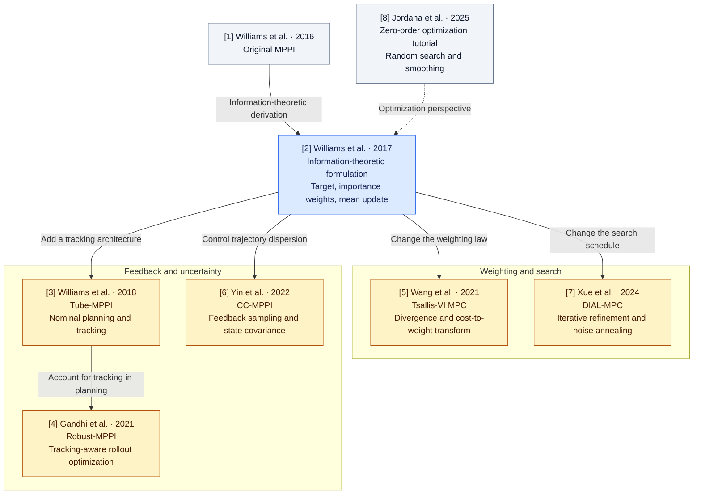

# MPPI Variant Playground

**Understand MPPI variants through their mathematics and observable behavior.**

This project is a research companion for readers who want to understand how Model Predictive Path Integral (MPPI) control and related sampling methods work. We study the choices behind each method: its objective, sampling distribution, cost-to-weight transformation, update rule, and feedback architecture.

Each investigation follows the same path:

**Derive the mechanism → predict its effect → isolate it in a small experiment → explain a control example.**

The current code provides an information-theoretic MPPI baseline, four fixed sampling covariance settings, numerical checks, and reproducible vehicle experiments on Linux/CPU. Studies of the broader algorithm families are planned. The [research questions](docs/research_questions.md) describe the experiments needed to investigate their defining features.

## MPPI in a paragraph

MPPI samples candidate control sequences, predicts their trajectories with a dynamics model, evaluates their costs, and uses weighted samples to update a control sequence. It executes the first command and repeats from the next observed state. Mathematical choices determine which trajectories are explored, how strongly they influence the update, and how feedback or uncertainty enters the calculation. Those choices are the subject of this repository.

## Paper map

The map organizes our eight references by the mathematical questions they help answer. Arrows show conceptual reading connections; they do not assert a formal citation graph or equivalence between methods. Numbers match the reference table below.



**Blue:** formulation used by the implemented baseline. **Amber:** families planned for investigation. **Gray:** historical or tutorial context. The node labels and table also identify each role.

| Ref. | Paper | What we study |
|---|---|---|
| [1] | Williams et al., [Aggressive Driving with Model Predictive Path Integral Control](https://doi.org/10.1109/ICRA.2016.7487277), ICRA 2016 | Historical introduction of MPPI. The implemented derivation follows [2]; full text of [1] was unavailable during the source review. |
| [2] | Williams et al., [Information Theoretic Model Predictive Control: Theory and Applications to Autonomous Driving](https://arxiv.org/abs/1707.02342v1), 2017 preprint | Optimal trajectory distribution, importance sampling, Gaussian mean projection, and control constraints. |
| [3] | Williams et al., [Robust Sampling Based Model Predictive Control with Sparse Objective Information](https://www.roboticsproceedings.org/rss14/p42.pdf), RSS 2018 | How nominal sampling-based planning is coupled to a trajectory tracker in Tube-MPPI. |
| [4] | Gandhi et al., [Robust Model Predictive Path Integral Control: Analysis and Performance Guarantees](https://arxiv.org/abs/2102.09027v1), RA-L 2021 | How nominal/actual dynamics and tracker capabilities enter planning and performance analysis. |
| [5] | Wang et al., [Variational Inference MPC using Tsallis Divergence](https://arxiv.org/abs/2104.00241v1), 2021 | How divergence choice changes the cost-to-weight transformation and policy updates. |
| [6] | Yin et al., [Trajectory Distribution Control for Model Predictive Path Integral Control using Covariance Steering](https://arxiv.org/abs/2109.12147v3), ICRA 2022 | How feedback sampling and covariance steering shape the distribution of future states. |
| [7] | Xue et al., [Full-Order Sampling-Based MPC for Torque-Level Locomotion Control via Diffusion-Style Annealing](https://arxiv.org/abs/2409.15610v1), 2024 preprint | How iterative sampling and annealing balance exploration with refinement in DIAL-MPC. |
| [8] | Jordana et al., [An Introduction to Zero-Order Optimization Techniques for Robotics](https://arxiv.org/abs/2506.22087v1), 2025 preprint | A broader view of random search, smoothing, and distribution-based optimization. |

Start with [2] for the baseline derivation and [8] for the optimization perspective. Follow [5] and [7] for weighting and search; [3] then [4] for tracking architectures; and [6] for state-distribution control. CEM is a related optimizer discussed in [2], [5], and [8] and is included as a planned study of elite selection and distribution fitting.

The [detailed paper map](docs/paper_map.md) records equation locations, reviewed versions, and reference software. The [investigation plan](docs/research_questions.md) connects each mechanism to a proposed experiment.

## What is implemented

The four available controller names select fixed proposal covariances within one IT-MPPI implementation. Covariances are expressed in normalized acceleration/steering coordinates.

| Configuration | Proposal covariance | Feature available to investigate |
|---|---|---|
| `standard` | `diag(0.28, 0.16)` | Proposal covariance equals the shared base covariance. |
| `isotropic` | `0.22 I` | Equal variance in both normalized input directions. |
| `diagonal` | `diag(0.34, 0.10)` | Independent input perturbations with unequal variances. |
| `full` | `[[0.28, 0.08], [0.08, 0.16]]` | Correlated acceleration/steering perturbations. |

All four use the same fixed base covariance, `diag(0.28, 0.16)`, and the full base/proposal density correction. This preserves a common target distribution while changing the sampling proposal. The proposals have equal trace, 0.44, which fixes total latent normalized variance; their determinants and behavior after actuator clipping differ. Samples remain independent across horizon steps. See the [mathematical formulation](docs/formulations.md).

**Planned:** CEM MPC, Tsallis-VI MPC, DIAL-MPC, Tube-MPPI, Robust-MPPI, and CC-MPPI. Their defining updates or feedback architectures are not implemented. The [fidelity report](docs/implementation_fidelity.md) documents the current scope.

## How to read the experiments

Existing vehicle runs illustrate the behavior of the fixed-covariance baseline. They include open space, a narrow passage, and a sudden disturbance; the code also supports an obstacle field and model mismatch. The saved records include executed trajectories, control commands, effective sample size (ESS, a measure of weight concentration), saturation, and timing.

Use these observations to ask a mathematical question. For example: does changing proposal geometry increase estimation variability? Does low ESS come from the cost transform or poor proposal overlap? How does clipping alter the sampled control distribution? Answer those questions with isolated probes before interpreting a vehicle trajectory.

The [results report](docs/results.md) preserves 180 recorded episodes across three budget modes, plus two additional environment checks. Native-mode trajectories duplicate the primary runs. These records cover the implemented covariance settings; studies of the broader families remain outstanding. The [protocol](docs/benchmark_protocol.md) defines budgets and metrics, and the [limitations](docs/limitations.md) explain the model and evidence boundaries.

## Read by interest

| If you want to… | Start here |
|---|---|
| Understand the literature and its connections | [Paper map and equation references](docs/paper_map.md) |
| Work through the implemented equations | [Mathematical formulation](docs/formulations.md) |
| Design an experiment around a mathematical feature | [Research questions and proposed probes](docs/research_questions.md) |
| Inspect recorded behavior and diagnostics | [Executed results](docs/results.md) |
| Reproduce the vehicle experiments | [Experimental protocol](docs/benchmark_protocol.md) |
| Check what the implementation actually supports | [Implementation fidelity](docs/implementation_fidelity.md) and [limitations](docs/limitations.md) |

## Run the playground

Requires Linux, Python 3.11+, and [uv](https://docs.astral.sh/uv/). The checked-in Python version is 3.12. Computation uses CPU NumPy; a GPU is unnecessary.

From the repository root:

```bash
uv sync --frozen
export OPENBLAS_NUM_THREADS=1 OMP_NUM_THREADS=1 MPLBACKEND=Agg
uv run ruff check .
uv run ruff format --check .
uv run pytest
```

Run one episode and reconstruct its figures and GIF:

```bash
uv run python experiments/run_single.py --controller standard --scenario open_space --seed 42 --output results/my_run
uv run python experiments/generate_figures.py --input results/my_run --animate
```

Select `standard`, `isotropic`, `diagonal`, or `full` with `--controller`. Select `open_space`, `narrow_passage`, `multiple_obstacles`, `disturbance`, or `model_mismatch` with `--scenario`. Output directories must be new; choose another name when repeating a run.

Reproduce the shared covariance experiment, or run a short smoke check:

```bash
# Four covariance settings, three scenarios, five seeds
uv run python experiments/run_benchmark.py --mode dynamics --output results/my_comparison
uv run python experiments/generate_figures.py --input results/my_comparison

# Four-step execution check
uv run python experiments/run_single.py --samples 64 --steps 4 --output results/my_smoke
```

The benchmark also accepts `--mode wall_clock` for offline latency-calibrated sample allocation and `--mode native` for the supplied configuration. Report the modes separately; the calibrated timing target permits deadline misses.

Each episode saves its resolved configuration, provenance, numerical results, trajectories, commands, diagnostics, and a compact rollout archive. CSV/JSON/YAML records and PNG/SVG figures can be versioned. Rollout archives and animations are ignored by Git and can be regenerated. GIF export is supported; MP4 export is not implemented.

## Repository guide

```text
configs/                       Dynamics, costs, controllers, scenarios, and budgets
src/                           Sampling, MPPI, dynamics, evaluation, and visualization
experiments/                   Episode, benchmark, and figure entry points
tests/                         Numerical identities, behavior, and reproducibility checks
docs/                          Derivations, paper map, study plans, and recorded findings
results/                       Experiment records and generated figures
.github/workflows/ci.yml        CPU lint, tests, and headless smoke checks
```

[Hydrax](https://github.com/vincekurtz/hydrax) and [MPPI-Generic](https://github.com/ACDSLab/MPPI-Generic) are reference implementations reviewed for design context. Their reviewed revisions and differences from this code are recorded in the [paper map](docs/paper_map.md#reference-implementation-review).
