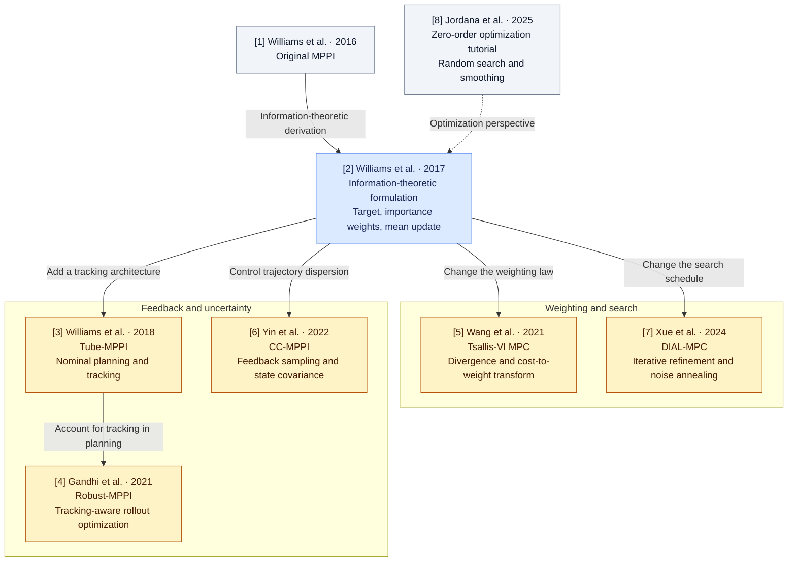

# Paper map: mathematical connections and source notes

Our references address three connected questions: how MPPI is derived, how sampling and weighting change the search, and how feedback or uncertainty changes planning. The diagram is a reading map; arrows describe conceptual connections rather than a verified citation graph. Reference numbers are shared with the [README bibliography](../README.md#paper-map).

**Blue:** implemented baseline formulation [2]. **Amber:** planned algorithm families [3]–[7]. **Gray:** historical or tutorial context [1], [8]. These colors indicate this repository's scope, not a classification of performance.

## Reading routes

| Question | Papers to connect | What to trace through the equations |
|---|---|---|
| Where does the MPPI update come from? | [1] historical context → [2] derivation | Objective, optimal density, importance ratio, and mean projection. |
| How does weighting change the update? | [2] → [5] | Exponential versus deformed transforms; parameter conventions, support, and policy updates. |
| How does iterative search change exploration? | [2] → [7], with [8] as context | Sampling scale, smoothing, noise stages, and refinement across iterations. |
| How does a tracker enter the controller? | [2] → [3] → [4] | Nominal/actual state separation, correction, tracking-aware sampling, and assumptions behind bounds. |
| What does controlling covariance mean? | [2] → [6] | Distinguish proposal control covariance from predicted state covariance and a prescribed terminal bound. |
| How do these ideas fit into optimization? | [8], read alongside [2], [5], and [7] | Random search, log-sum-exp smoothing, and distribution optimization; preserve each method's objective and assumptions. |

The current isotropic, diagonal, and full proposals are settings of the baseline [2]. They provide a study of sampling geometry; CC-MPPI [6] additionally requires feedback sampling and a state-covariance design. CEM is a related optimizer discussed in [2], [5], and [8], with no separate CEM paper in this reference set.

For each reading route, the [investigation plan](research_questions.md) specifies a mechanism-specific experiment. The equation locations below anchor the derivations; the [fidelity report](implementation_fidelity.md) states which mechanisms are implemented.

## Source map and verified equation locations

Reviewed on 2026-10-28. Equation references below refer to the linked versions, and can differ in later publications. Planned-controller entries record a formulation review, not an implementation-fidelity claim.

| Reference | Material reviewed / role | Verified locations |
|---|---|---|
| [1] [Williams et al., ICRA 2016](https://doi.org/10.1109/ICRA.2016.7487277) | Historical original reference. Publisher access returned a JavaScript/robot check; full text was not accessible in this session. We do **not** claim a verified equation-by-equation reproduction of this paper. | No equation numbers asserted. The implemented baseline uses [2]. |
| [2] [Williams et al., 1707.02342v1](https://arxiv.org/html/1707.02342v1) | Main derivation, importance sampling and saturation-in-dynamics reviewed before baseline implementation. | (14) optimal density; (20) mean projection; (21) base/proposal importance ratio; (22) equal-covariance control law; §III-D3 constraints inside dynamics. |
| [3] [Williams et al., RSS 2018](https://www.roboticsproceedings.org/rss14/p42.pdf) | Nominal planning and tracking architecture with sparse task costs. | (9) optimal-control expectation; (10) iterative sampling update. No claim to implement its tracker. |
| [4] [Gandhi et al., 2102.09027v1](https://arxiv.org/html/2102.09027v1) | Architecture and augmented-rollout algorithm reviewed. | (7) nominal dynamics; (8) tracking-aware actual dynamics; (9) tracker contraction assumption; Algorithm 1 augmented importance sampler. |
| [5] [Wang et al., 2104.00241v1](https://arxiv.org/html/2104.00241v1) | Deformed exponential, objective, target density and Gaussian update reviewed. | (6) paper's $\exp_r$ convention; (9) Tsallis objective; (10) transformed density; (14)–(15) Gaussian mean/covariance updates. |
| [6] [Yin et al., 2109.12147v3](https://arxiv.org/html/2109.12147v3) | Linearization, feedback sampling and steering constraint reviewed. | (7)–(9) linearization; (10) control with $K_ky_k$ feedback; (11) auxiliary noise response; (14c) terminal state-covariance bound. |
| [7] [Xue et al., 2409.15610v1](https://arxiv.org/html/2409.15610v1) | Diffusion interpretation, coverage/convergence trade-off and annealing reviewed. | (1) exponential update; (2) score interpretation; (4) determinant annealing schedule; Algorithm 1 iterated sampling. |
| [8] [Jordana et al., 2506.22087v1](https://arxiv.org/html/2506.22087v1) | Conceptual distinction between smoothing-based search and distribution optimization. | §III-B log-sum-exp/MPPI; (24)–(25) optimization over a distribution; (27) covariance/mean natural-gradient schematic. |

For example, [5] uses $\exp_r(x)=[1+(r-1)x]_+^{1/(r-1)}$ and explains that other Tsallis conventions require a parameter conversion. Its generalized transform, cutoff and scale must be derived together; replacing an exponential by an arbitrary power is not sufficient. [7] motivates multiple noise stages and time-dependent exploration; a renamed fixed covariance does not implement DIAL-MPC.

## Reference implementation review

No source files were copied, no upstream packages are required, and no license has been added to this repository.

- **Hydrax**, reviewed main revision [`bd53d43d414e19557d38ee6c72613bf2e39fe834`](https://github.com/vincekurtz/hydrax/tree/bd53d43d414e19557d38ee6c72613bf2e39fe834). Inspected `hydrax/alg_base.py` and [`hydrax/algs/mppi.py`](https://github.com/vincekurtz/hydrax/blob/bd53d43d414e19557d38ee6c72613bf2e39fe834/hydrax/algs/mppi.py). It samples Gaussian perturbations of spline knots and uses cost-only softmax weights to fit a mean. Its docstring identifies an MPPI-generic formulation. Our code uses direct controls at every time step and a fixed-base density correction; its optimizer is not interchangeable with that cost-only update. We adopt the modular separation of task, dynamics and optimizer as a design reference, using CPU NumPy instead of JAX/MJX.
- **MPPI-Generic**, reviewed main revision [`abcd1ab419cb27efa113573932adbde1e0380835`](https://github.com/ACDSLab/MPPI-Generic/tree/abcd1ab419cb27efa113573932adbde1e0380835). Inspected [`include/mppi/controllers/MPPI/mppi_controller.cu`](https://github.com/ACDSLab/MPPI-Generic/blob/abcd1ab419cb27efa113573932adbde1e0380835/include/mppi/controllers/MPPI/mppi_controller.cu) and [`include/mppi/sampling_distributions/gaussian/gaussian.cu`](https://github.com/ACDSLab/MPPI-Generic/blob/abcd1ab419cb27efa113573932adbde1e0380835/include/mppi/sampling_distributions/gaussian/gaussian.cu). The Gaussian sampler explicitly computes a likelihood-ratio control cost, with a `lambda*(1-alpha)` scale and configured control-cost coefficients. Sign and scaling depend on its calling convention; our ratio is independently derived from Gaussian log densities and tested against SciPy. We do not port its CUDA kernels, tracking controllers, or performance claims.

The reference review is limited to those files. It is not an audit of either complete project.
