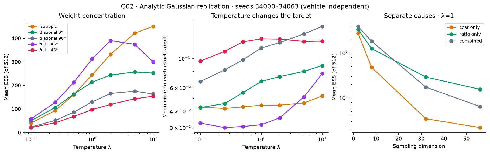

# Q02 — Importance-weight concentration

**Status: EXECUTED**

## Research question

When do cost weighting and Gaussian density corrections concentrate importance weights, and how does ESS relate to error?

## Mathematical motivation

ESS=1/Σw² measures weight concentration, whereas estimator variance also depends on the integrand.

## Hypothesis

Sharper Boltzmann factors and high-dimensional proposal mismatch can each concentrate weights.

## Independent variables

Temperature and dimension; cost-only, ratio-only and combined controls.

## Controlled variables

Analytic target recomputed for each temperature; paired seeds and sample budgets within each comparison.

## Metrics

ESS, entropy, largest weight, exact mean error and Gaussian overlap diagnostics.

## Main finding

In the isotropic K=512 slice, mean ESS rises from 41.95 at λ=.1 to 453.29 at λ=10 while mean error is nonmonotonic. Separate dimension probes isolate cost and density-ratio concentration.

## Interpretation

ESS summarizes normalized weights. Temperature changes the target; density ratios alone can concentrate in high dimensions.

## Limitations

This is not a fixed-target temperature accuracy ranking or a causal diagnosis of every vehicle failure. Finite ESS does not certify population overlap.

## Configuration and provenance

[Original configuration](../../results/investigations/temperature_v1/config.yaml)

Source run IDs: temperature_v1

- [Run temperature_v1](../../results/investigations/temperature_v1/): [manifest](../../results/investigations/temperature_v1/manifest.json), source `dd50f534ad47e765bec39715f6f801b790a251b2`.

## Selected figure



[Numeric summary](../../results/investigations/temperature_v1/summary.csv)

## Reproduce and regenerate

```bash
uv run python experiments/temperature_sweep.py --output runs/Q02/temperature_reproduction
uv run python experiments/temperature_sweep.py --output results/investigations/temperature_v1 --plots-only
```

[Full methods, interpretation and additional figures](../covariance_mechanisms.md)
