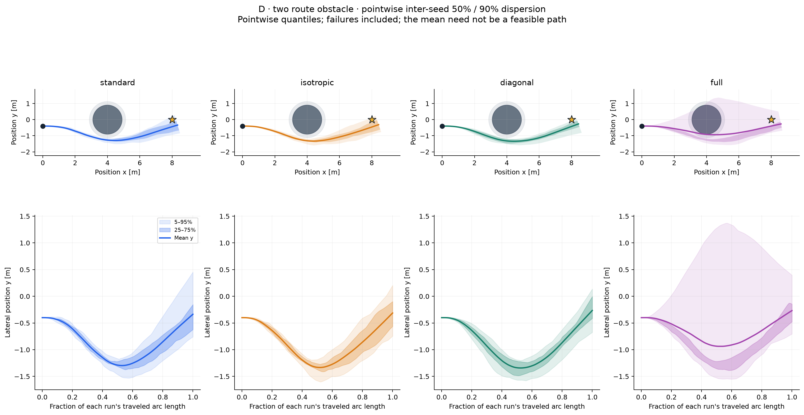

# Q04 — Closed-loop trajectory differences

**Status: EXECUTED**

## Research question

Closed-loop trajectory differences?

## Mathematical motivation

Closed-loop feedback changes observed states and warm starts, so static estimation benefits need not transfer.

## Hypothesis

Proposal changes may accumulate into visibly different route and recovery distributions.

## Independent variables

Four covariance settings and four scenarios across 20 paired seeds.

## Controlled variables

Costs, dynamics, limits, budgets and exogenous disturbances within each scenario.

## Metrics

Completion, collision, clearance, route station crossing, occupancy, ESS and progress-aligned dispersion.

## Main finding

The full setting takes 3 upper and 17 lower station crossings in the two-route task; others take 20 lower. Its aligned mean path has −0.206 m clearance despite collision-free individual executions.

## Interpretation

Executed bundles, occupancy, local rollout clouds and inter-seed dispersion describe different distributions. A mean over routes need not be feasible.

## Limitations

States and warm starts differ across closed-loop variants. Twenty seeds and one matrix per structure do not isolate covariance as the sole cause of route choice.

## Configuration and provenance

[Original configuration](../../results/investigations/trajectory_behavior_v1/config.yaml)

Source run IDs: trajectory_behavior_v1

- [Run trajectory_behavior_v1](../../results/investigations/trajectory_behavior_v1/): [manifest](../../results/investigations/trajectory_behavior_v1/manifest.json), source `077e7d90eb2f2d3fd302a284daf5d9868bf28135`.

## Selected figure



[Numeric summary](../../results/investigations/trajectory_behavior_v1/behavior_summary.csv)

## Reproduce and regenerate

```bash
uv run python experiments/trajectory_density_study.py --scenarios narrow_passage open_space sudden_disturbance two_route_obstacle --output runs/Q04/trajectory_reproduction
uv run python experiments/trajectory_density_study.py --output results/investigations/trajectory_behavior_v1 --plots-only
```

[Full methods, interpretation and additional figures](../trajectory_behavior_findings.md)
