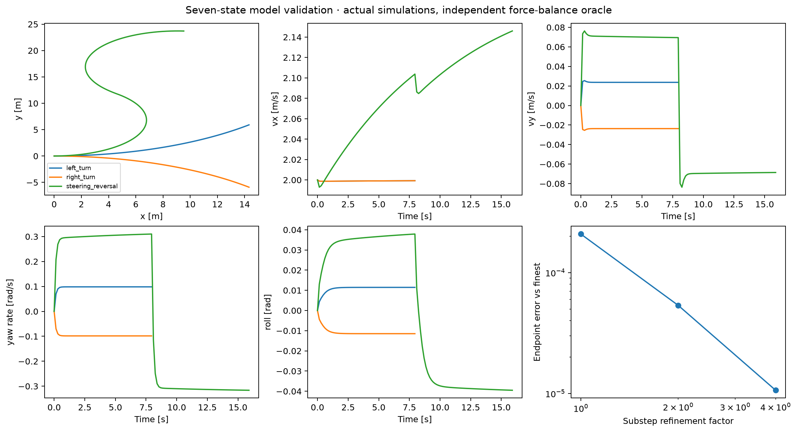

# Seven-state dynamic vehicle campaign

This document distinguishes model validation, analytic checks and vehicle experiments. The validated physics approximation and actual Q01–Q05 records are separate from the preserved historical four/five-state evidence. The [pre-implementation audit](seven_state_audit.md) records the starting scope.

## Motivation and relation to the paper

The new plant adds body lateral velocity, yaw dynamics and a dynamic roll response to expose effects absent from the original kinematic vehicle. It preserves `[px,py,heading,roll,vx,vy,yaw_rate]` and steering/throttle inputs. The original four-state and separate five-state models remain available, and their evidence is retained.

The [2017 paper, §VI-B](https://arxiv.org/html/1707.02342v1#S6.SS2) uses this state/input description with dynamic updates fitted from driving data. Our equations and parameters are an illustrative physics approximation, not its identified basis-function or neural network model, AutoRally calibration, or real-vehicle reproduction.

## Exact implemented equations

Let yaw be ψ, roll φ, forward/lateral velocities u,v, yaw rate r, steering δ and signed normalized throttle a. Body x points forward, y left and z up. Positive steering/yaw turn left. Positive roll raises the left side, corresponding to outward roll during a left turn. All lengths, masses, forces and time use SI; a is dimensionless.

With L=lf+lr, static axle loads Zf=mg lr/L, Zr=mg lf/L, regularization q=√(u²+ε²), and w=u²/(u²+ε²):

$$\alpha_f=\delta-\operatorname{atan2}(v+l_f r,q),\qquad
\alpha_r=-\operatorname{atan2}(v-l_r r,q),$$
$$F_f=w\mu Z_f\tanh(C_f\alpha_f/(\mu Z_f)),\qquad
F_r=w\mu Z_r\tanh(C_r\alpha_r/(\mu Z_r)).$$

Rear-body propulsion/braking is Fd=Fe a for a≥0 and Fb a for a<0. Drag is c1 u+c2 u|u|. The applied forces and yaw moment are

$$F_x=F_d-c_1u-c_2u|u|-F_f\sin\delta,$$
$$F_y=F_f\cos\delta+F_r-m(1-w)v/t_0,$$
$$M_z=l_fF_f\cos\delta-l_rF_r-I_z(1-w)r/t_0.$$

The seven derivatives are

$$\dot p_x=u\cos\psi-v\sin\psi,\quad
\dot p_y=u\sin\psi+v\cos\psi,\quad\dot\psi=r,$$
$$\dot\phi=(hF_y-k_\phi\phi)/c_\phi,\quad
\dot u=F_x/m+vr,\quad\dot v=F_y/m-ur,\quad\dot r=M_z/I_z.$$

Roll is an explicit overdamped torque-balance state, not an algebraic equilibrium substitution. It affects the objective and finish checks but does not feed back into the planar force equations in this approximation. Roll inertia/rate is omitted to retain seven states; its relaxation time is cφ/kφ=.4 s. Tire loads remain static: this model omits load transfer, a friction ellipse, suspension/contact and roll-to-grip feedback. Tire forces saturate smoothly rather than remaining unbounded linear forces. Low-speed blending and viscous lateral/yaw relaxation avoid singular slip divisions and spurious steering forces at rest. These are disclosed regularizations, not an identified low-speed tire law.

Parameters are in [vehicle.yaml](../configs/seven_state/vehicle.yaml): mass 35 kg, yaw inertia 8 kg m², lf=lr=.4 m, Cf=Cr=450 N/rad, μ=.9, Fe=70 N, Fb=105 N, CG height .2 m, net roll restoring stiffness 120 N m/rad and damping 48 N m s/rad. Positive throttle propels; negative throttle brakes. Reverse driving is disabled. A forward-speed governor projects midpoint and accepted speeds to [0,4] m/s; steering is clipped to ±.5 rad and throttle to ±1. The model has no hidden steering servo/rate state or actuator lag.

Integration is explicit midpoint RK2 with dt=.15 s and three substeps, h=.05 s. Predictions and executions use the same integrator, except for explicitly declared physical parameter mismatch. Collision checks sweep the disk over each integration substep's straight segment; continuous curved motion between these substeps is still an approximation.

## Model validation

Validation covers zero equilibrium, straight throttle driving, constant steering, steady turning, left/right symmetry, reversal, braking without reverse, lateral/yaw/roll transients, near-zero perturbations, bounds and refinement convergence. The turning oracle independently solves nonlinear tire/force balances at fixed speed. Fitted XY curvature is compared with that dynamic oracle; kinematic u tan(δ)/L is not treated as exact.

The model must pass `runs/seven_state/validation/dynamics_v1/validation.json` before any campaign driver runs. Nonfinite integration raises; there is no fallback to another vehicle. The [formal validation](../runs/seven_state/validation/dynamics_v1/validation.json) passed all 12 grouped checks before MPPI evaluation. Independent steady-turn yaw rate was .0983484939 rad/s; simulated .0983481878. Expected lateral velocity .0236797029 m/s; measured .0236797698. Expected roll .0114696678 rad; measured .0114693667. Expected curvature .0491893316 m⁻¹; fitted .0491888933. Independent force-balance residual was 3.16×10⁻¹⁴. Endpoint refinement errors against eight-substep refinement were .00020847, .00005355 and .00001063 for 1×, 2× and 4× the default substep count. The refinement comparison holds the commanded control interval fixed.



This verifies internal consistency of the declared model, not agreement with a measured vehicle. Validation trajectories, config and source provenance are retained alongside the check results.

## Protocol

The same shared MPPI planner, full latent p/q correction and base distribution are used within a condition. Control order is **steering, throttle**, with physical transform `clip(diag(.5,1) z, bounds)`. New proposals have normalized trace .40: standard diag(.14,.26), isotropic .20 I, diagonal diag(.09,.31), full [[.14,.07],[.07,.26]]. The fixed base is diag(.14,.26). These are not the old acceleration/steering covariances under new names. Q03 also rotates matched-eigenvalue (.30,.10) proposals using local cost sensitivity, without inferring control directions from XY geometry.

The covariance labels describe different geometric interventions. Before clipping, for one zero-mean control perturbation:

| Proposal | Steering standard deviation [rad] | Throttle standard deviation | Steering/throttle correlation | Latent determinant |
| --- | ---: | ---: | ---: | ---: |
| Standard | .1871 | .5099 | 0 | .0364 |
| Isotropic | .2236 | .4472 | 0 | .0400 |
| Diagonal | .1500 | .5568 | 0 | .0279 |
| Full | .1871 | .5099 | .3669 | .0315 |

Isotropic reallocates variance toward steering relative to standard; diagonal reallocates it toward throttle. Full preserves both marginal variances and adds positive coupling. For paired standard normals, full has εδ=√.14 z₁ and ετ=(.07/√.14)z₁+√(.26−.07²/.14)z₂. This explicitly changes which steering/throttle combinations are sampled together. Trace matching alone therefore does not make exploration equivalent. The same 2×2 covariance is repeated independently across horizon steps; no temporal covariance is introduced.

Primary driving uses K=384, T=20, temperature 8 and desired body-forward speed 1.4 m/s. Sampling dimension is **2T=40**, not seven. Optimizer stream entropy is [4400,seed], disturbance entropy [4401,seed], and Q03 paired normals/reference streams use disjoint [101,state_index,seed] / [202,state_index,rep] namespaces. Disturbance impulses are realized once per seed and shared across proposals.

Q04 covers open space, a narrow passage, a two-route circle, a step-20 impulse and execution-model tire stiffness reduced to 70% of planning stiffness. Seeds 42–61 are a compatibility/examined cohort. Separate seeds 31000–31019 are holdouts. Neither cohort is silently pooled into the other's summary.

Q05's corridor is generated around an actually executed seven-state reference steering maneuver (+/−/+ lobes with speed feedback), not a kinematic turning-radius oracle. Offset normals use course direction including lateral slip. The existing exact polygon/segment geometry and disk radius .22 m are reused. Clearances .90,.60,.35,.20 m are declared before comparison. Reference steering/throttle, swept clearance, lateral velocity, yaw and roll are checked for each condition. The reference profile has a rate bound for feasibility, but MPPI steering is an instantaneous angle input; a genuine actuator-rate study requires additional history/augmentation and is not claimed here.

The seed-42 pilot precedes holdouts 32000–32019. If any primary marginal Wilson interval has width >.36, every Q05 condition expands to 40 paired seeds using 32020–32039. This is a predeclared precision rule, not selection for a preferred covariance. Additional secondary studies here vary K=128,384,768,1536 at a declared Q04 obstacle task and Q05 clearance .35; speed, friction, horizon and cost remain fixed. These are equal-rollout-budget, not equal-wall-clock-budget comparisons.

The common finish region uses terminal progress shortfall ≤.30 m, lateral goal error ≤.40 m, heading error ≤.35 rad, vx error ≤.8 m/s, |vy|≤.35 m/s, |r|≤.35 rad/s and |roll|≤.15 rad, without collision. Progress is projected/clipped to the route endpoint, so later recovery in a straight runout is allowed; Euclidean goal error is retained. This is not a stopped-point or first-crossing-only criterion. Timeouts are censored at 160 steps (24 s), and completion time is reported only among completions.

## Q01 — analytic reproducibility

The independent replication used seeds 34000–34063, 447 cases and 28,608 trials with the original declared target parameters. It is independent of vehicle dynamics. Original records remain under `results/investigations/gaussian_v1`; new records are under [Q01](../runs/seven_state/Q01/seven_state_q01_v1/).

For the fixed quadratic target and K=256:

| Proposal | MSE | Bias norm | Empirical variance trace | Mean ESS |
| --- | ---: | ---: | ---: | ---: |
| Isotropic | .006505 | .014268 | .006401 | 121.69 |
| Diagonal 0° | .015121 | .003751 | .015347 | 107.71 |
| Full +45° | .003646 | .010488 | .003592 | 154.89 |
| Diagonal 90° | .054718 | .029452 | .054705 | 72.05 |
| Full −45° | .065524 | .016936 | .066273 | 54.98 |

At K=4096 the corresponding MSE values are .000300, .001479, .000160, .004220 and .026790. Favorable and unfavorable orientations both remain visible; this supports a geometric finite-sample effect rather than a universal advantage for full covariance. Bias is an empirical 64-seed mean; with sample variance using n−1, empirical MSE equals squared bias plus (n−1)/n times variance trace. The orientation panel fixes the proposal mean at zero; shifted-mean cases remain in the data and are not connected into the same curve.

## Q02 — concentration and accuracy

The analytic temperature/dimension replication used the same 64 independent seeds, 71 cases and 4,544 trials. At isotropic K=512, mean ESS goes from 40.56 at λ=.1 to 450.61 at λ=10, while mean estimation error changes from .04284 to .05207. Temperature changes the exact target: this is not an accuracy comparison for one fixed target. The dimension controls separately apply cost-only, density-ratio-only and combined log weights; all have exact Gaussian target moments appropriate to that control.

Dimension controls at λ=1, K=512 (mean ESS / mean Euclidean mean-estimation error):

| Weight control | d=2 | d=56 |
| --- | ---: | ---: |
| Cost only | 278.84 / .0331 | 2.17 / 4.1203 |
| Density ratio only | 338.47 / .0943 | 15.52 / 2.5530 |
| Combined | 394.54 / .0286 | 6.41 / 2.0078 |

The controls define different targets, so errors cannot be ranked as competing estimators of one target across rows. They isolate sources of concentration. Raw Euclidean error also changes with dimension; exact moments and all trials remain available.

Vehicle diagnostics are separately labeled. For example, Q04 holdout two-route episode-mean ESS is 106.95 standard, 10.62 isotropic, 8.71 diagonal and 6.54 full at K=384. Successful closed-loop traversal can coexist with strongly concentrated weights. The full proposal also changes route frequencies. Neither fact certifies the accuracy of a single MPPI update. [Selected snapshot decompositions](../runs/seven_state/Q04/seven_state_q04_v1/selected_weight_components.csv) separate cost-only, ratio-only and combined ESS at the predeclared snapshot steps. These diagnostic controls do not change the executed controller or establish a causal decomposition of failure. Vehicle sampling dimension is 2×20=40; the state dimension is seven.

## Q03 — frozen decisions

The new campaign executed **7,200 decisions**: three frozen states, six proposals, eight K values and 50 paired seeds 33000–33049. Source seed 31415 is separate. The source controller is standard: this fixes one reference policy and one warm start per state, rather than a proposal-neutral distribution of encountered states. Every proposal receives that same frozen input. A raw audit verified 1,026 saved populations, shared inputs and paired normals, latent likelihood ratios, normalized weights and weighted control updates. Open-space input is step 8; obstacle input is the first declared x-window state with independently feasible upper/lower route witnesses; post-disturbance input is step 21. Selection does not inspect which proposal wins. Exact frozen states and warm starts are committed.

Each high-sample reference pools eight independent batches of 65,536 rollouts (524,288 per state), with disjoint reference streams. Pooling uses log masses; reported uncertainty is a delete-block jackknife, not a bound on self-normalized importance-sampling bias.

| Frozen state | Pooled ESS | Largest weight | Minimum batch ESS | RMS CI half-width | Declared diagnostic status |
| --- | ---: | ---: | ---: | ---: | --- |
| Open space | 101.18 | .06123 | 5.00 | .09271 | unresolved |
| Pre-obstacle | 1.51 | .80955 | 1.03 | .72621 | unresolved |
| Post-disturbance | 129,950.55 | .0000882 | 16,063.30 | .00288 | diagnostically usable |

Only the last passes the predeclared overlap and precision screens. Even that status is a finite-sample diagnostic, not proof of all target modes being found. The other distances are distances to unresolved estimates, not validated target errors.

Post-disturbance normalized plan RMS distance to the usable reference:

| Proposal | K=64 | K=384 | K=4096 |
| --- | ---: | ---: | ---: |
| Standard | .10853 | .04549 | .01401 |
| Sensitivity aligned | .24713 | .23591 | .15975 |
| Sensitivity misaligned | .18179 | .11148 | .05014 |

The aligned/misaligned matrices share eigenvalues .30,.10 and trace .40. “Aligned” means alignment with the negative gradient of J(U+1_T d) at d=0: a constant two-channel latent offset across the horizon, differentiated with central steps .001 and .0005. It is not the unknown target covariance or a Hessian-optimal proposal. Both finite-difference gradients and their relative change are recorded. The base prior, proposal mean and full 40-dimensional overlap also determine importance weights. Thus alignment alone need not improve this estimator; the observed negative result is retained. Paired distances between updates can remain substantial even where a reference is unresolved.

The [microscope](../results/showcase/Q03_key.png) uses one predeclared obstacle decision, seed 33000. It shows the first 48 unweighted paths, at most 64 displayed weighted paths, all 384 weighted endpoints, and the updated nominal prediction. All panels share limits derived from the full saved population bounds. Lowest raw cost and highest corrected weight are marked independently; they differ in this example because corrected weights also contain p/q. It is neither an executed path nor an occupancy distribution. [First-command distributions](figures/seven_state_Q03_commands.png) and [K convergence with intervals](figures/seven_state_Q03_convergence.png) use all 50 seeds. The “nominal” trajectory is a nonlinear rollout of the weighted latent mean, not a weighted average of state trajectories.

## Q04 — closed-loop propagation

The five-scene study executed 800 episodes at K=384: 400 compatibility episodes (seeds 42–61) and 400 holdout episodes (31000–31019). Completion was **397/400 compatibility** and **391/400 holdout**, with **zero collisions** in either cohort. Every episode and 133 saved populations passed the replay/likelihood audit. The mismatch execution really uses Cf=Cr=315 N/rad while planning uses 450; it is not an identically configured plant. The disturbance is a shared seed-dependent step-20 state impulse; there is no robust tracking controller or forecast.

Holdout completions (n=20 per cell):

| Scenario | Standard | Isotropic | Diagonal | Full |
| --- | ---: | ---: | ---: | ---: |
| Open space | 20 | 20 | 20 | 20 |
| Narrow passage | 19 | 20 | 20 | 18 |
| Two-route obstacle | 20 | 20 | 20 | 18 |
| Disturbance | 20 | 19 | 19 | 18 |
| Model mismatch | 20 | 20 | 20 | 20 |

These proportions have broad uncertainty: 20/20 has a Wilson 95% lower bound about .839. A difference of one or two completions is not a robust ranking. Paired success/cost differences are in `paired_differences.csv`; compatibility results remain separate in `summary.csv` and the primary figure. Goal position, heading and speed error summaries are in `goal_summary.csv`.

In holdout two-route trials, upper-route counts are 5 standard, 5 isotropic, 2 diagonal and 17 full out of 20. This is a characteristic of these proposal matrices under accumulated feedback, not a causal comparison at common states. Positive steering/throttle coupling in the full setting supplies a plausible exploration mechanism for more upper routes, but the experiment does not isolate that explanation from its changed weight concentration and subsequent warm starts. A negative-correlation counterpart would be a separate controlled test. Corresponding mean episode evaluation costs are 248.51, 259.26, 252.83 and 259.19, and mean per-command planning times under this execution load are 50.42, 52.40, 51.93 and 53.01 ms. No equal-time or real-time claim follows. Cost includes censored failures; completion time is conditioned on completion. Mean paths over routes need not be feasible, so the primary figure shows individual representative executions selected by seed 31000 before outcomes.

## Q05 — S-turn outcomes

The seed-42 pilot completed 15/16 conditions, with one full-proposal timeout at .20 m and no collisions. No controller/environment retuning followed. The independent primary sweep used seeds 32000–32019 and completed **313/320 episodes**, with **zero collisions and seven timeouts**.

| Clearance [m] | Standard | Isotropic | Diagonal | Full |
| --- | ---: | ---: | ---: | ---: |
| .90 | 20/20 | 19/20 | 20/20 | 20/20 |
| .60 | 20/20 | 20/20 | 20/20 | 20/20 |
| .35 | 20/20 | 19/20 | 20/20 | 20/20 |
| .20 | 20/20 | 16/20 | 20/20 | 19/20 |

The widest primary marginal Wilson 95% interval is [.584,.919] (width .335) for isotropic at .20 m. It does not exceed the declared .36 expansion threshold, so the seed set remains 20 for every setting. This is a bounded precision rule, not a claim that the uncertainty is small. At .20 m the paired isotropic-minus-standard success difference is −.20, with a descriptive pointwise t interval [−.392,−.008]; full-minus-standard is −.05 [−.155,.055]. These are not simultaneous intervals across the campaign. The difficulty threshold is unresolved, and nonmonotonic cells are retained.

Every clearance has an executed feasible reference: 105 control steps (15.75 s < 24 s), two steering reversals, peak steering .2606 rad, profile rate .3592 rad/s and throttle ≤1. Actual reference substep-swept minimum clearance is .8971,.5974,.3477,.1979 m respectively. This reference uses the seven-state physics, not a kinematic-radius oracle. Peak reference |vy|=.1446 m/s, |yaw rate|=.4441 rad/s and |roll|=.03395 rad. Feasibility metadata is in `conditions.json`; MPPI does not receive the reference controls.

The closed-loop body response differs substantially from that mild feasible witness. At .35 m, mean episode peak |vy| is .394/.447/.390/.414 m/s for standard/isotropic/diagonal/full; peak |yaw rate| is 1.307/1.316/1.299/1.337 rad/s and peak |roll| .155/.157/.153/.157 rad. Their mean ESS is only 4.77/2.09/2.23/1.99 out of 384. Thus tighter geometry exposes dynamic and sampling behavior even when most trials complete; a success-only table would miss this. The primary figure includes vy, yaw and roll traces from predeclared seed 32000 at .35 m. At .90 m that same isotropic seed fails; it remains in the data and failure table rather than being replaced by a successful example.

Planning time at K=384 averaged roughly .306–.342 s per command across primary S-turn cells, versus dt=.15 s. This CPU implementation/run configuration does not demonstrate real-time control. The later K studies report their own measured timings and work counts rather than transferring the faster circle-scene measurements.

## Sample-budget sensitivity

Both selected scenarios use K=128,384,768,1536 at the same horizon, temperature, model, cost, limits and paired holdout seeds. Each sweep has 320 rows, but only 240 new episodes: 80 K=384 rows reference original primary episode paths. No raw arrays were copied for those rows.

Q04 two-route completions (20 seeds per cell):

| K | Standard | Isotropic | Diagonal | Full |
| --- | ---: | ---: | ---: | ---: |
| 128 | 18 | 20 | 16 | 17 |
| 384 | 20 | 20 | 20 | 18 |
| 768 | 20 | 20 | 20 | 20 |
| 1536 | 20 | 20 | 20 | 20 |

Q05 clearance .35 m completes 20/20 in every K/proposal cell except isotropic K=384 (19/20). The nonmonotonic success count is retained. All budget-sweep episodes are collision-free. Mean S-turn cost from K=128→1536 decreases 1612.46→1481.90 standard, 1683.11→1519.39 isotropic, 1569.77→1479.31 diagonal and 1653.94→1478.49 full. At K=1536, mean ESS is 91.92 standard versus 4.60 full while both complete 20/20. Thus similar traversal outcomes can coexist with quite different sampling diagnostics.

Per-command work includes K sampled sequences and one updated nominal prediction:

| K | Predicted transitions, (K+1)T | RK2 RHS evaluations, 6(K+1)T |
| --- | ---: | ---: |
| 128 | 2,580 | 15,480 |
| 384 | 7,700 | 46,200 |
| 768 | 15,380 | 92,280 |
| 1536 | 30,740 | 184,440 |

Per-episode work additionally depends on executed steps; exact counters are retained per seed. Execution and one-step model-check transitions are separate from prediction counters. Equal K is a per-decision rollout budget, not equal total episode work or wall time. Later stages ran concurrently, while reused K=384 records retain their original timings. These campaign timings cannot establish a clean latency scaling law across K. Single-process timing probes are reported separately below.

## Separate S-turn secondary checks

The preferred-cruising-speed/disturbance study used **400 new episodes**, seeds 35000–35019, clearance .35 m and K=384. Geometry and terminal speed remain fixed at the original 1.4 m/s reference. The speed axis changes only the running-cost speed preference, not the geometric reference or a hard speed constraint. This changes the objective across speed levels; cross-level cost numbers are not errors for one fixed target.

| Condition | Standard | Isotropic | Diagonal | Full |
| --- | ---: | ---: | ---: | ---: |
| Preferred speed 1.0 m/s | 20/20 | 20/20 | 20/20 | 18/20 |
| Preferred speed 1.4 m/s, no impulse | 20/20 | 20/20 | 20/20 | 20/20 |
| Preferred speed 1.8 m/s | 20/20 | 20/20 | 20/20 | 20/20 |
| Lateral impulse .10 m | 17/20 | 16/20 | 17/20 | 18/20 |
| Lateral impulse .20 m | 15/20 | 11/20 | 13/20 | 9/20 |

The baseline is executed once and reused in the two secondary plot panels, not stored as duplicate raw records. The two failures at preferred speed 1.0 are full-proposal terminal-speed timeouts. No parameters were retuned after observing a secondary outcome.

The step-40 impulse is a seven-coordinate state jump: magnitude times `[0,1,.2,.02,−.5,.3,.1]`, multiplied by the common seed factor. It is neither a continuous physical force nor a forecasted disturbance. There are **44 collisions** in these secondary impulse checks: all 12 at .10 m occur at the imposed jump; at .20 m, 30 occur at the jump and two afterward. These are kept, audited and explicitly separated from the collision-free primary clearance campaign. The unperturbed corridor has a feasible witness; recovery feasibility from each induced jump is **unresolved**. Immediate exogenous boundary exits must not be interpreted as failures to recover after the jump, physical infeasibility of the corridor, or proof of poor covariance-family optimization. See [secondary failure records](../runs/seven_state/Q05/seven_state_q05_secondary_v1/failure_modes.csv).

### Discrete steering command slew

The controller can constrain the change in commanded steering using its already known previous command while retaining seven plant states. For rate b, each latent sequence is amplitude-clipped and then projected recursively so |δ_t−δ_(t−1)|≤b dt; the updated nominal sequence uses the identical transform anchored at the previous executed command. Both p/q densities and the weighted update remain in unprojected latent coordinates. This is a discrete command slew constraint, not a continuous steering servo/lag model.

The declared .4,.8,1.6 rad/s levels all admit the same physical reference (maximum discrete profile rate .3592 rad/s), with fixed geometry, preferred speed, cost and K. Seeds 37000–37019 are independent of prior cohorts. The plant equations and physics validation remain unchanged; constrained sampled and nominal trajectories, pre-projection densities, executed slew bounds and default-unconstrained equivalence are tested before evaluation.

RATE_OUTCOMES_PENDING

### Isolated planning-time measurements

TIMING_OUTCOMES_PENDING

## Uncertainty, failure interpretation and scientific scope

Binary marginal intervals use Wilson 95% intervals. Continuous means and paired seed differences use descriptive pointwise Student-t intervals; they are not simultaneous confidence bands or corrected multiple-comparison tests. Pairing controls optimizer/disturbance streams within a condition but closed-loop paths subsequently observe different states. Computational timing was measured with the same per-plan timer and one BLAS thread per worker; parallel process load and software/hardware affect latency. Exact transition/RHS counters support work comparisons even when timing is noisy.

All 12 Q04 failures violate the lateral goal tolerance; eight also miss the speed tolerance and three miss heading. No Q04 failure has insufficient projected progress. In Q05 all seven failures miss terminal speed; one also has insufficient progress and one misses the lateral goal tolerance. This is consistent with stopping/overshooting near a forward-only finish region, not evidence that the corridor is physically impossible. Exact terminal states and violated checks are in `failure_modes.csv` under each primary run. The .90 m isotropic failure stops at x=27.31 m, y=−.675 m; the reference goal is around x=20.51 m, y=−.021 m. This makes the runout limitation concrete: projected progress can be 1 while Euclidean position error is large or speed is invalid. The common terminal objective does not penalize positive longitudinal overshoot, and no recovery/parking controller is provided. These are protocol limitations, not hidden successes.

The mathematical target stays fixed within a covariance intervention, and all full-rank Gaussian proposals retain latent support. This does not imply an unbiased finite-K self-normalized estimate, a useful ESS, reliable high-sample coverage, or monotonic realized error at every K. Clipping changes the physical pushforward distribution and saturation, but densities are correctly evaluated before clipping. Trace matching does not match determinant, entropy, physical dispersion or task-relevant directions.

Supported: covariance orientation can help or harm exact-target estimation; cost and density ratios can each concentrate weights; locally aligned exploration need not minimize estimator error; frozen finite-K controls differ at identical inputs; feedback propagates those differences into route and completion distributions. Unsupported: universal covariance-family superiority, reproduction of AutoRally dynamics, certified collision safety, physical impossibility inferred from MPPI failure, or superiority of another published MPPI formulation.

Q06 remains **PLANNED**. Future work should test genuine alternative weighting/feedback architectures, multiple calibrations and corridor handedness, wider horizons, better independent reference proposals, and secondary difficulty axes. The plant retains instantaneous steering input; the optional controller command-slew projection uses explicit previous-command history. A continuous actuator/servo model remains future work. Preferred-cruising-speed and state-jump checks are separate completed studies, not inferred from the clearance/K sweeps. The existing five-state rate study remains historical evidence, not a substitute seven-state result.

## Source provenance

Manifests preserve the source commit, full source/configuration hashes and original dirty flag. Some later records have `dirty: true` while presentation/analysis edits were underway; they must not be presented as clean-checkout provenance. The physical model, cost, sampler and shared controller have a common recorded engine fingerprint, and raw replay verifies the saved dynamics, weights and decisions. Exact executed configurations and all original provenance flags remain intact. The Q04 pilot finalization repair is explicitly recorded in its manifest and did not rerun optimization.

## Storage and reproduction

New immutable run IDs are under `runs/seven_state/Q01`–`Q05`. Exact YAML, small CSV/JSON summaries, selected representative traces/plot inputs and manifests are committed; full episode records and rollout NPZs are ignored local data. Cloning alone does **not** supply those raw arrays. No LFS or external object store is configured, so reproducing raw evidence requires executing the recorded commands. Figures read saved compact inputs or raise if required data is absent; they never launch optimization or resample.

```bash
uv sync --frozen
export OPENBLAS_NUM_THREADS=1 OMP_NUM_THREADS=1 MPLBACKEND=Agg
uv run python experiments/validate_dynamic_vehicle.py --output runs/seven_state/validation/dynamics_v1
uv run python experiments/seven_state_campaign.py --stage q01 --output runs/seven_state/Q01/seven_state_q01_v1
uv run python experiments/seven_state_campaign.py --stage q02 --output runs/seven_state/Q02/seven_state_q02_v1
uv run python experiments/seven_state_campaign.py --stage q03 --output runs/seven_state/Q03/seven_state_q03_v1
uv run python experiments/seven_state_campaign.py --stage q04 --output runs/seven_state/Q04/seven_state_q04_v1
uv run python experiments/seven_state_campaign.py --stage q05 --output runs/seven_state/Q05/seven_state_q05_v1
uv run python experiments/seven_state_campaign.py --stage budget_q04 --output runs/seven_state/Q04/seven_state_q04_budget_v1
uv run python experiments/seven_state_campaign.py --stage budget_q05 --output runs/seven_state/Q05/seven_state_q05_budget_v1
uv run ruff check .
uv run ruff format --check .
uv run pytest
```

Use fresh suffixed IDs for reproductions; completed run directories are never overwritten. The five primary figures are curated under `results/showcase`; supporting figures are committed under `docs/figures`. The registry links exact source commits/config hashes, primary and historical runs, and reconstruction commands. The previous five-state primary figure is preserved at `results/archive/five_state_Q05_key.png`; previous four-state figure/data paths remain intact.
