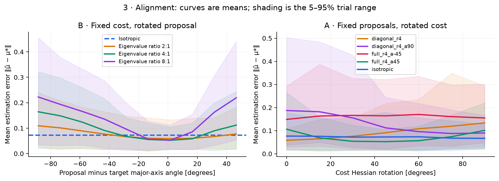
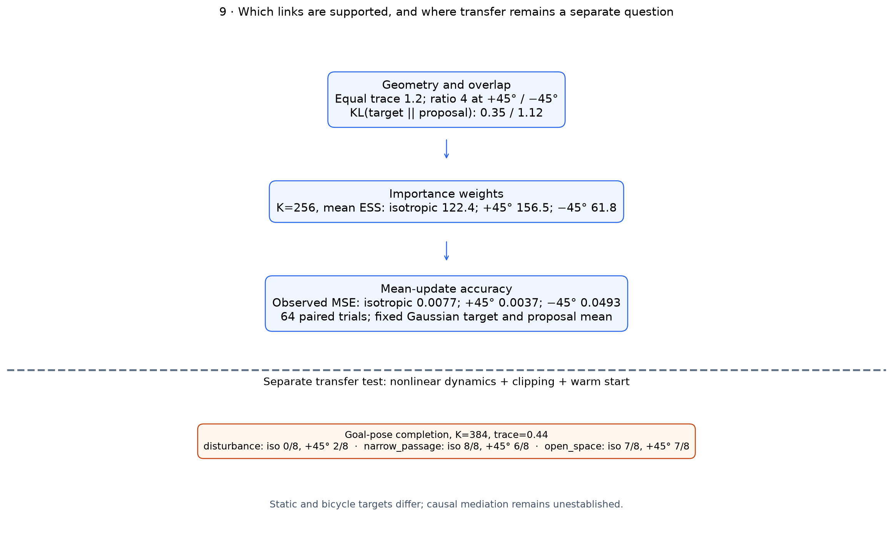

# Fresh covariance mechanism results

All five studies were executed again from the committed research branch into this new output directory. The 35,472 per-case trial records reproduce the original non-timing values exactly. All 720 executed trajectories and 720 control sequences match byte for byte. Timing and process-peak memory are machine-dependent and were excluded from exact comparisons. See `reproduction_check.json` for the audit.

## Fixed-target Gaussian result

The exact target mean is independent of proposal covariance. This experiment holds base, quadratic cost, temperature, proposal mean, sample budget and covariance trace fixed. It measures how accurately finite samples estimate that same target mean. The displayed slice uses the 45° quadratic, K=256, temperature 1, trace 1.2 and 64 independent replicate seeds, paired across proposals.

| Proposal | MSE | Empirical bias norm | Estimator variance trace | Mean ESS / 256 |
|---|---:|---:|---:|---:|
| Isotropic | 0.007657 | 0.002753 | 0.007771 | 122.4 |
| Diagonal, 0° | 0.013140 | 0.005525 | 0.013318 | 111.1 |
| Full, +45° | 0.003699 | 0.005769 | 0.003724 | 156.5 |
| Diagonal, 90° | 0.017705 | 0.060134 | 0.014312 | 76.3 |
| Full, −45° | 0.049254 | 0.028692 | 0.049200 | 61.8 |

Changing correlation sign while retaining the same eigenvalues changes target coverage and weight concentration. The +45° and −45° proposals have correlation +0.6 and −0.6 respectively, with the same marginal variances and trace. The chosen +45° proposal reduces observed estimation variance; the −45° proposal produces larger errors and violates the finite importance-weight second-moment condition. A finite batch can still have finite ESS in that case. This is a conditional result for the declared target and covariance scale, not a general ranking of covariance families.

## Additional mechanisms

- The sample-count sweep covers K=32–4096. Error quantiles, empirical bias, estimator variance and paired differences are saved. An individual seed's error need not decrease monotonically.
- Temperature changes the target. For isotropic sampling at K=512, mean ESS rises from 41.95 at temperature 0.1 to 453.29 at temperature 10; each error uses its own temperature-specific exact mean.
- The clipping study holds latent trace at 0.88 in its scale-2, zero-mean slice. Applied normalized covariance trace is about 0.6869 for isotropic and 0.6143 for the axis-aligned ratio-4 proposal. Equal latent trace does not ensure equal applied exploration.
- All 960 nonconvex trials discover the declared target basin at the tested budget. The fitted target mean and best visited objective point remain separate quantities. The two-well Gibbs mean is approximately (0.6872,0), while its global cost minimizer is (1,0).

## Separate bicycle transfer check

The table uses K=384, normalized trace 0.44, unchanged costs/dynamics/constraints, and eight paired seeds. These are different targets from the static quadratic problem.

| Task | Isotropic | Full, +45° |
|---|---:|---:|
| disturbance | 0/8 | 2/8 |
| narrow passage | 8/8 | 6/8 |
| open space | 7/8 | 7/8 |

Across all 720 control episodes, 415 succeed and 305 fail; no collisions or actuator/speed violations are observed. Eight seeds per cell give broad uncertainty. These observations do not establish a universal ordering or prove that ESS causes a particular control outcome.

## Files in the bundle

Each `*_v1` folder includes exact configuration, case definitions, per-trial CSV, descriptive summaries, paired differences, provenance, and PNG/SVG figures with numerical arrays. Control episodes additionally include resolved configurations, trajectory/command/diagnostic CSVs and result JSONs. The bundle omits large per-episode `rollouts.npz` files; they remain in the local run directory. Displayed rollout subsets are preserved in the figure-data archives.

The original source is available at https://github.com/hdoh-ucsd/mppi-variant-playground/tree/codex/covariance-mechanism-study . Mathematical derivations, test outcomes and the complete seminar guide are in the repository's `docs/covariance_mechanisms.md`, `docs/mathematical_investigations.md` and `docs/experimental_findings.md`.
